# OpenPostPro

**An open-source CAD/CAM tool for drawing, preparing toolpaths, and generating machine code.**

OpenPostPro brings together a lightweight 2D drawing environment, CAM operations, and configurable Python post-processors. Import a DXF drawing or create geometry directly in the application, prepare machining or cutting operations, then generate output adapted to your machine through a post-processor.

The current version is **0.6**. The project is still in an **early development stage**: it is usable, but some geometry and toolpath algorithms can still fail on difficult shapes, so generated output must always be checked carefully before being used on a real machine.

## 🗺️ How it fits together

Overview: three zones, CAD, post-processor and simulator. The output file is the border between the machine and the check. The boxes have three colors: green = user Python (what you write), purple = engine Python (provided, do not edit), grey = OpenPostPro application (the C++ program).

```mermaid
flowchart LR
  subgraph CAD["CAD"]
    s["CAD script<br/>(user Python)"]:::user -->|"core.line(...), core.circle(...)"| cc["cadcore.py<br/>(provided engine Python)"]:::eng
    cc -->|"text commands<br/>M:id:A:... D:id G:text Y:layer"| doc["Application: reads the commands,<br/>changes the Document"]:::app
    doc --> par["Toolpaths<br/>(pockets, outlines)"]:::app
  end
  subgraph PP["Post-processor"]
    app2["Application: walks<br/>the toolpaths"]:::app -->|"start_loop, rapid, linear..."| pc["postcore.py<br/>(provided engine Python)<br/>state: position, line number, feed"]:::eng
    pc <-->|"calls the methods,<br/>gets text back"| post["Post-processor<br/>(user Python, one per machine)"]:::user
    pc --> out["Output file<br/>(G-code, HPGL)"]:::app
  end
  subgraph SIM["Simulator"]
    app3["Application: gives<br/>one line at a time"]:::app -->|"start, next, close, extensions"| tr["Translator<br/>(user Python, one per format)"]:::user
    tr -->|"dictionaries"| cv["Application: simple commands<br/>(sim_translator.cpp)"]:::app
    cv --> pl["Player"]:::app --> mat["Material model<br/>(grid or tiles)"]:::app --> vue["3D view"]:::app
  end
  par --> app2
  out ==>|"border: machine | check"| app3
  classDef user fill:#99d5cf,stroke:#0f766e,color:#052e2b
  classDef eng fill:#d9ccf2,stroke:#6d4fc2,color:#2a1a5c
  classDef app fill:#d9dde2,stroke:#5b6670,color:#1f2933
```

## ✏️ Draw and prepare geometry

OpenPostPro includes tools to create and edit 2D geometry directly:

- Points, lines, circles, arcs, ellipses, polylines, splines, and text
- **Text along a curve**: a text can follow a line, an arc, a circle or any chain of connected shapes (select the text, then **Drawing → Link the text to a curve** or the button of its properties, and click the curve). The letters keep their size, the start of the text is set with a slider, the text can go round a closed curve, and it goes on in a straight line past the end of an open one. The text follows its curve when the curve is moved with the mouse or when the origin or the unit is changed; the button of its properties and the refresh button of the toolpaths read the curve again in the other cases
- Geometric transformations such as offset, mirror, scale, rotation, and moving the origin
- **Extend**: prolongs a line or an arc, from the end nearest to the mouse, up to the nearest other entity, with a preview of the result under the mouse
- **Cut**: splits lines, arcs, circles, polylines, and ellipses at the clicked point (the magnet stays active) or at the crossing of the shapes under the click
- **Contour** (Edit → Select): from the selection, selects every shape connected to it
- **Check the drawing** (Drawing menu): finds the shapes of length zero, the shapes drawn twice, and the free ends (open contours), with markers on the drawing
- Chamfer and fillet (CAD scripts), cut at intersections, and boolean operations to combine, subtract, or intersect supported shapes
- DXF import for supported drawing entities, including lines, points, circles, arcs, ellipses, elliptical arcs, polylines, splines (B-splines and NURBS), texts, and blocks (INSERT, nested, with their position, scale and rotation). The ends of lines and arcs which are less than 0.01 apart are joined into one contour
- DXF export (AutoCAD R12): lines, circles, arcs, points, polylines, splines of lines and arcs (kept exact with bulges), texts, layers and colors; only the selected shapes if there is a selection
- SVG import and export, Gerber (RS-274X) and Excellon import: CAD scripts of the **Import** and **Export** menus
- Document unit (millimetres or inches), with the conversion of an imported DXF or of the whole drawing
- Layers (a layer can be locked: its shapes can not be moved, edited, deleted, cut or extended, but the magnet still snaps to them), undo and redo, and a magnet to snap to the points of the drawing

## 🐍 Python scripting for CAD
OpenPostPro also supports Python scripts at the CAD level. Scripts can create or modify geometry directly inside the application, making it possible to automate repetitive work or generate complex shapes parametrically instead of drawing every element by hand. They receive the current selection, the position of the mouse and the unit of the document, can show a properties dialog, and each run is undone in a single step.

The application ships with a library of scripts, grouped by category in the **Scripts** menu:

- **Generation**: rectangle, hexagon, star, oblong hole, wheel spokes, exterior involute gear, airfoil from a coordinate file, grid of holes
- **Geometry and modification**: linear and polar arrays, fillet, chamfer, center of gravity, scale of circles
- **Import** and **Export**: SVG import and export, Gerber and Excellon import (pads, tracks, regions, holes), bitmap tracing with the external program Potrace
- **Examples**: small scripts to start from (middle of lines, rectangle...)

The delivered scripts are read-only: use **Clone** to make your own editable copy, with a built-in editor that checks the syntax and shows the Python traceback in the log. Scripts are separate from post-processors: CAD scripts generate drawing geometry, while post-processors translate CAM operations into machine-specific output.

Guide: [Writing a CAD script](docs/CAD-SCRIPTS.en.md) · [Écrire un script CAO](docs/CAD-SCRIPTS.fr.md)

## ⚙️ CAM operations

Create toolpath operations from your drawing, grouped by tool, with the depth, the pass depth, and the feeds set per group:

- **Follow** — follow selected geometry, with an optional entry and exit (a line or a quarter of circle) and the **radius compensation** of the tool, or the kerf of a plasma torch (G41 / G42): the tool is centered on the line, outside or inside of the shape, and the side is deduced from the direction of the path
- **Offset** — create interior or exterior offsets
- **Pocket** — generate pocketing toolpaths, with three strategies: zigzag (scan lines at any angle, adjustable stepover, with or without the contour), concentric offsets, and spiral (inward or outward). Finishing passes are machined last, and islands are respected
- **Drilling** — configure drilling cycles, including peck drilling, tapping, and boring options
- **Spiral** — create spiral toolpaths
- **Move to** — add a positioning move
- **Tabs** (holding bridges) on closed follow and offset paths, with independent positions that can be moved with a slider, and a choice of the start point of the path

A button of the Groups tab computes the toolpaths again from their shapes (the selected ones, or all of them) after the drawing has been modified.

**Tools and machines.** A **table of tools** (cutters and torches: plasma, water jet, wire EDM) gives a group its diameter, feeds, pass depth, spindle and cooling, and a **table of cutting data** by material computes them from the diameter and the number of teeth. A group which uses a torch hides the settings it does not have, and the pocket and drilling buttons are disabled. The tool can **go down obliquely** along the entry of a path instead of plunging. A **machine** gives the area of the table, the zero and the direction of the axes (X counting from the right to the left, for instance): the area is drawn under the drawing, and the post-processor and the simulator follow the axes.

Guide: [Tools, torches and machines](docs/TOOLS-MACHINES.en.md) · [Outils, torches et machines](docs/TOOLS-MACHINES.fr.md)

CAM operations have configurable parameters. Because the project is still young, the results, especially outline, offset, and pocket calculations, may not be reliable for every shape or machining situation.

## 🎞️ Simulation

The **Simulation** tab plays a G-code program on a block of material, in 3D, before it is sent to a machine. It loads the output of the current post-processor (or any G-code file, which can also be dropped on the window), shows the toolpaths (feed and rapid moves), the tool and the material taken away by it (flat, ball, bull nose, V cutter or plasma torch), and measures the time of the machining from the feed rates.

- Play, pause, step by command or by line, go back, go to a line (a click in the text of the program), go to the final result, speeds from x1 to x500 and full speed. The stops (M0, optional M1) and the dwells of the program are executed as a machine does, and skipped when the simulator goes fast.
- The program is translated by a **Python translator** (`simulator/gcode.py` for generic G-code: moves, arcs, helices, canned cycles, units, planes, spindle, coolant, tools) into a few simple commands which the simulator plays. A translator for another controller or format only needs the three methods `start`, `next` and `close` (see the guide below).
- It is a check of the program, not a model of the machine: the cutter radius compensation (G41 / G42) is not applied, and the axes A, B, C are ignored.

Guide: [Simulator and translators](docs/SIMULATOR.en.md) · [Simulateur et traducteurs](docs/SIMULATOR.fr.md)

## 🧩 Python post-processors

Post-processors are written in Python, making machine-output customization accessible without changing the C++ application. They can be cloned and edited from the application.

Guide: [Writing a post-processor](docs/POSTPROCESSOR.en.md) · [Écrire un post-processeur](docs/POSTPROCESSOR.fr.md)

The repository includes generic post-processors for:

- **Milling / router**
- **Plasma cutting**

and the variants of some controllers, each for milling and for plasma cutting: **Mach3** (`.tap` file, absolute arc centers with `G90.1`), **Num 1060** (spaces between the words, no `G64`, dwell with `F`) and **Burny 2.5** (every arc gives `X Y I J`, dwell with `F`). **HPGL** is a post-processor for plotters and vinyl cutters (arcs cut into short segments, the tool number is the pen). A variant is a short file which derives from the generic one and writes only what differs: a good model for your own controller.

Post-processor settings include output file extension, decimal precision, line numbering, comments, header and footer, coordinate units, and relative or absolute arc-centre coordinates. The plasma post-processor also exposes settings for torch commands, start delay, reference setup, and Z-axis handling.

These are generic starting points, not guaranteed profiles for every controller. Review and adapt the output to your machine and controller before use.

## 🌍 Interface and technology

The interface language is managed through key/value files in `openpostpro/lang`. English (UK and US), French, Spanish, German, Italian, Dutch, and Brazilian Portuguese are included, and the language and unit are chosen at the first start. The log can be docked at the bottom of the window, and **Help → About** shows the version and the build date.

OpenPostPro is written in **C++20** and uses:

- **OpenGL 3** for rendering
- **Dear ImGui** for the user interface
- **GLFW** for window and input handling
- **GLM** for mathematics
- **FreeType** for font rendering
- **Python 3.12 or later** embedded for post-processors and scripts (stable ABI, no recompilation needed when Python is updated)

## 🖥️ Running on Windows

The current project files and bundled runtime libraries target Windows. A ready-to-use archive (`OpenPostPro-v<version>-win64.zip`) is published in the **Releases** section of the repository: unzip it anywhere and run `openpostpro.exe`.

You need:
- **Python 3.12 or later**, installed with **"Add Python to PATH"** checked. OpenPostPro does not ship Python: `python3.dll` is found through the PATH, and without it Windows reports "python3.dll was not found" at startup. The same installation provides the standard library and tkinter (used by some CAD scripts).
- The **Microsoft Visual C++ x64 Redistributable**

You can also build the application yourself. The project includes a Visual Studio solution at `openpostpro/openpostpro.sln`.

## 🛠️ Building from source

1. Install Visual Studio with C++ desktop development tools, and Python 3.12 or later (with "Add Python to PATH"). The Python headers and `python3.lib` are taken from the repository (`src/third/python`, `lib/python`).
2. Open `openpostpro/openpostpro.sln`.
3. Build the solution for the appropriate x64 configuration (Debug adds a **Debug** menu with development functions; Release does not).
4. The `copy_libs_output.bat` script, run by the solution after the build, copies the required runtime resources beside the executable: fonts, language files, post-processors, scripts, textures, shaders, and `freetype.dll`.

The version number, the build number, and the build date shown in the About window are in `openpostpro/src/common/version.h` (the date is the compilation date).

The source contains relatively few Windows-specific parts, and Linux or macOS builds may be possible, but **neither has been tested yet**.

## ✅ Tests

The tests check the parts that are the most delicate: the geometry used by the offsets, the pockets, and the cut and extend tools, and the CAD scripts.

- **Python** (CAD scripts and their geometry library): `python tests/run_tests.py`
- **C++** (geometry, pockets, extend and cut), built with Visual Studio's compiler and run without any window: see the header of each file in `tests/cpp` for what it checks, build it with the matching `build_*.bat`, then run the `.exe`. The exit code is 0 when everything passes.

Run them after any change to the geometry code (`curve.cpp`, `geometry.cpp`, `pocket.cpp`, the cut and extend files).

## 🐧 Linux and macOS

OpenPostPro is designed with cross-platform compatibility in mind, with very few dependencies on Windows-specific features. The application was successfully compiled and run on **Ubuntu 21.04** in the past, using Visual Studio Code. This demonstrates that building and running OpenPostPro on Linux is feasible, although the exact build setup has not yet been documented and may need to be recreated. macOS should also be a possible target, but has not yet been tested. Contributions to restore, document, and validate builds on these platforms are welcome.

## 🚧 Project status

OpenPostPro is version 0.6, an independent open-source project. The main priority for future improvement remains the robustness and precision of geometry and outline calculations (offsets and pockets on difficult shapes); some algorithms still use floating-point precision and need further work. The format of the document files may still change before a 1.0 version.

Please treat generated toolpaths and machine code as output that requires verification. Simulate or inspect the program and check machine settings, tool definitions, clearances, feeds, and speeds before running it on physical equipment.

Bug reports, feedback, and contributions are welcome.

## 📜 License

OpenPostPro is released under the **GNU Affero General Public License v3.0 or later (AGPL-3.0-or-later)**. See [`LICENSE`](LICENSE) for the full license text.

Third-party components keep their own licenses, all compatible with the AGPL; see [`THIRD_PARTY_LICENSES.md`](THIRD_PARTY_LICENSES.md).

## 🔗 Links

- **Repository:** https://github.com/rebisway/openpostpro
- **Contact:** contact@rebisway.com

I had great fun building OpenPostPro. I hope you enjoy exploring it, using it, and helping it improve.
