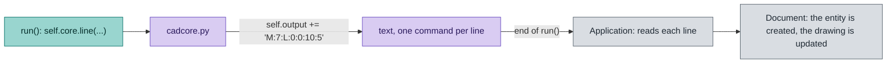

# CAD script API reference

*Version française : [CAD-SCRIPTS.fr.md](CAD-SCRIPTS.fr.md).*

This is the reference for anyone who writes a CAD script: a Python file that creates geometry (lines, circles, arcs) in the drawing, at the position of the mouse. It lists every method of the `Cadscript` class and every call of the engine, with arguments, when it is called and an example. The bundled `script/oblong.py` (an oblong hole, with a `tkinter` dialog) is the reference implementation. Post-processors are in [POSTPROCESSOR.en.md](POSTPROCESSOR.en.md).

Covered here: installation, the life cycle of a run, the methods of `Cadscript`, the drawing calls of the engine and a complete minimal example.

## 0. Conventions

### Files and loading

| Item | Rule |
|---|---|
| Location | the `script` folder beside the executable |
| Loading | at startup, each `.py` file is copied to `~/.openpostpro/script` and loaded from there |
| Name | your own (`my_rectangle.py`): the copy **overwrites files of the same name** |
| Class | the file defines a class named `Cadscript` |
| Library files | a `.py` file without the `class Cadscript` line is a module shared by other files (like the engine): it is imported, not listed in the menu |
| Read-only | a file shipped with the application cannot be edited in the application: use **Clone** to make an editable copy under a new name and description |
| Menu | Edit (own files only), Clone, Open folder (the folder in `~/.openpostpro`) |
| Editor | **Save** or Ctrl+S writes the file, **Compile** checks the syntax and reloads the file. A Python error is written in the log with its traceback |
| Engine | `cadcore.py` is the engine. It is never loaded as a script. Do not edit it |
| Errors | written to `~/.openpostpro/openpostpro.log` |
| Python | 3.12 or later, installed with "Add Python to PATH" (see the README) |
| `tkinter` | write `import tkinter`: `cadcore.py` already points Python to the Tcl/Tk libraries of the installed Python |

### Who calls whom

```
OpenPostPro (C++)  ->  Cadcore (cadcore.py)  ->  Cadscript (your file)
```

The engine hands itself to your class: it is `self.core`, set through `set_core()`. Your class draws by calling `self.core`; the engine collects the drawing as text and returns it to the application when `run()` ends.

### Types and encodings

- Coordinates are numbers in drawing units (`float`).
- `cw` of an arc is a boolean: `True` for clockwise.
- Language codes: `en-us`, `en-uk`, `fr-fr`, `es-es`.

## 1. Life cycle of a run

```
set_language(lang)    when the script is loaded
set_core(core)        once
get_description() get_category()    to build the Scripts menu
get_property / set_property         loading and saved values
-- when the user launches the script --
core.mouse_x / mouse_y are set      position of the mouse
run()                               the script draws and may open a dialog
-> the drawing returned by the engine is added to the document
```

A file without a `class Cadscript` is not a script: it is skipped and not listed in the menu. Use such a file for code shared by several scripts (`import my_tools`). When a script fails, the log gives the Python traceback, with the file and the line of the error.

From the Python function to the drawing: the script calls the engine, which writes short text commands, read by the application when `run()` ends.



The commands are one per line: `M:id:L:x1:y1:x2:y2` (segment), `M:id:C:x:y:r` (circle), `M:id:A:...` (arc), `D:id` (delete), `G:text` (log), `Y:layer` (layer).


## 2. Methods of `Cadscript`

| Method | Arguments | Returns | Meaning |
|---|---|---|---|
| `set_language(value)` | `'en-us'`, `'en-uk'`, `'fr-fr'` or `'es-es'` | nothing | selects the dictionary of interface strings |
| `set_core(value)` | the engine | nothing | store it in `self.core`; do not modify |
| `get_description()` | none | string | name shown in the Scripts menu |
| `get_category()` | none | string | menu of the Scripts menu: `'generation'`, `'geometry'`, `'modify'`, `'import'`, `'export'` or `'examples'` (translated by the engine), or any other name used as it is |
| `get_properties_count()` | none | number | number of parameters of the script |
| `get_property_description(index)` | index from 0 | string | label of the parameter |
| `get_property_key(index)` | index from 0 | string | optional: name used to save the value (default: the index) |
| `get_property_file(index)` | index from 0 | `None` or `(mode, filter name, pattern)` | optional: makes a text property a file name, see below |
| `use_properties()` | none | `bool` | optional: `False` if the script shows its own window (default `True`) |
| `get_property(index)` | index from 0 | `bool`, `int`, `float`, `str` or `list` of `str` | current value |
| `set_property(index, value)` | index, value | nothing | receives the saved value at startup, or the edited one |
| `run()` | none | nothing | creates the geometry through `self.core` |

If `get_properties_count()` returns more than 0, OpenPostPro displays the properties dialog box (same controls as the post-processors, see POSTPROCESSOR.en.md section 4) when the script is chosen. **Ok** sends the values through `set_property` and runs the script; **Cancel** stops it. The values are saved per script and given back at the next call. Return a stable name from `get_property_key` so that adding or reordering properties never mixes the saved values.

A script can also manage its own window (for example `tkinter`, to open a file dialog): return `False` from `use_properties()` and no dialog box is displayed; `oblong.py` is such an example.

## 3. Engine calls (`self.core`)

### Position of the mouse

| Attribute | Type | Meaning |
|---|---|---|
| `self.core.mouse_x` | `float` | X of the mouse when the script is launched |
| `self.core.mouse_y` | `float` | Y of the mouse when the script is launched |

Use it as the origin of the shape.

### Unit and selection

| Attribute | Type | Meaning |
|---|---|---|
| `self.core.unit` | `str` | unit of the document, `'mm'` or `'inch'`: all the coordinates are in this unit |
| `self.core.selection` | `list` of `dict` | the shapes selected when the script is chosen (toolpaths are not listed) |
| `self.core.drawing` | `list` of `dict` | all the shapes of the document, in every layer, in the same format: for the scripts which export the drawing |

The selection is read when the script is chosen in the menu: it does not change while the properties dialog box is open. It is empty if nothing is selected. Each shape is a dictionary with the keys `id` (unique number of the shape in the document), `layer` (name of its layer) and `type`, then the keys of its type. Points are tuples `(x, y)`.

| `type` | Other keys |
|---|---|
| `'line'` | `p1`, `p2` |
| `'circle'` | `center`, `radius` |
| `'arc'` | `start`, `center`, `stop`, `cw` (`True` for clockwise), `radius` |
| `'point'` | `p1` |
| `'ellipse'` | `center`, `major`, `minor`, `start`, `stop`, `angle` (angles in radians) |
| `'polyline'` | `points` (list of tuples), `mode` (`'polyline'`, `'bspline'`, `'natural_cubic'`, `'lagrange'`, `'catmull'` or `'bezier'`), `closed` |
| `'spline'` | `segments` (list of dictionaries), `closed` |
| `'text'` | `p1`, `text`, `family`, `height`, `inter`, `bold`, `italic` |

The segments of a spline are dictionaries with `type` (`'line'`, `'arc'` or `'circle'`) and `point`. A segment starts at its `point` and ends at the `point` of the next one; for an arc or a circle, `center`, `radius` and `cw` give its curve.

```python
for shape in self.core.selection:
	if shape['type'] == 'line':
		x1, y1 = shape['p1']
		x2, y2 = shape['p2']
		self.core.circle((x1 + x2) / 2, (y1 + y2) / 2, 2.0)
```

`mark_middles.py` is a complete example of a script that reads the selection.

### Log and layers

| Call | Effect |
|---|---|
| `self.core.log(text)` | writes a line `Script: text` in the log of the application (`print` is not visible) |
| `self.core.set_layer(name)` | the shapes added after this call go into the layer of this name, created if it does not exist (the creation is undone with the script); without a name, they go back to the current layer. A modified shape keeps its layer |

### File dialogs

| Call | Effect |
|---|---|
| `self.core.open_file(title, filters, initial)` | displays a dialog box (`tkinter`) to choose a file to open; returns the path, or `''` if the dialog is cancelled or cannot be displayed. `filters` is a list of `(name, pattern)`, for example `[('SVG', '*.svg'), ('All files', '*.*')]`; a pattern can hold several extensions: `'*.gbr;*.drl'`. All the arguments are optional |
| `self.core.save_file(title, filters, initial, extension)` | the same to choose a file to write; `extension` (`'.svg'`) is added to a name written without one |

Prefer a **file property** when the file is a parameter of the script: return `('open', 'SVG', '*.svg')` (or `'save'`) from `get_property_file(index)` for the index of a text property, and the properties dialog box shows a `...` button which opens the file dialog of the application, next to the text. The method is optional: without it, a text property is a plain text field. The values are saved as for any other property. A script can still call `open_file` when the path is empty or wrong, as `svg_import.py` does.

```python
def get_property_file(self, index):
	return ('open', 'SVG', '*.svg') if index == 0 else None
```

### Messages

| Call | Effect |
|---|---|
| `self.core.message(text, title)` | displays a message box (`tkinter`) and waits for the user to close it; `title` is optional (the name of the script by default). If the box cannot be displayed, the script goes on |

### Modifying and deleting

| Call | Effect |
|---|---|
| `self.core.modify_line(id, x1, y1, x2, y2)` | changes the points of a line |
| `self.core.modify_circle(id, x, y, r)` | changes the center and the radius of a circle |
| `self.core.modify_arc(id, x1, y1, cx, cy, x2, y2, cw)` | changes the start, the center, the end and the direction of an arc |
| `self.core.modify_point(id, x, y)` | changes a point |
| `self.core.modify_ellipse(id, cx, cy, major, minor, start, stop, angle)` | changes an ellipse (`start`, `stop`, `angle` in radians, default `0` and `2*pi` for a whole ellipse, `0`) |
| `self.core.modify_polyline(id, points, mode)` | changes the points (list of `(x, y)`) and the mode of a polyline |
| `self.core.modify_spline(id, segments)` | changes the segments of a spline (list of dictionaries, same format as the selection) |
| `self.core.modify_text(id, x, y, text, height, family, bold, italic, inter)` | changes a text |
| `self.core.remove(id)` | deletes a shape |

`id` is the `id` key of a shape of `self.core.selection`. A modification changes the parameters only: a line stays a line, and the shape keeps its `id`, its layer and its toolpaths. Applying `modify_circle` to the id of a line is refused and written to the log. Deleting a shape does not delete the toolpaths that use it.

All the changes, the new shapes included, are undone in one step. `scale_circles.py` is an example, and so are `fillet.py` and `chamfer.py`: they round or cut the corners of the selected lines, splines made of lines and polylines. `chamfer.py` reuses the code of `fillet.py` (`import fillet`), which shows how scripts can share code.

### Drawing

| Call | Arguments | Effect |
|---|---|---|
| `self.core.line(x1, y1, x2, y2)` | start, end | adds a line |
| `self.core.circle(x, y, r)` | center, radius | adds a circle |
| `self.core.arc(x1, y1, cx, cy, x2, y2, cw)` | start, center, end, direction | adds an arc from `(x1, y1)` to `(x2, y2)` around `(cx, cy)`; `cw` is `True` for clockwise |
| `self.core.point(x, y)` | position | adds a point |
| `self.core.ellipse(cx, cy, major, minor, start, stop, angle)` | center, axes, range, orientation | adds an ellipse; `start`, `stop` and `angle` are in radians and optional (whole ellipse, not rotated) |
| `self.core.polyline(points, mode)` | list of `(x, y)`, mode | adds a polyline; `mode` is `'polyline'` (default), `'bspline'`, `'natural_cubic'`, `'lagrange'`, `'catmull'` or `'bezier'`; repeat the first point to close it |
| `self.core.spline(segments)` | list of dictionaries | adds a spline: each segment has `type` (`'line'`, `'arc'` or `'circle'`) and `point`, and for an arc `center`, `radius`, `cw` (see the selection) |
| `self.core.text(x, y, text, height, family, bold, italic, inter)` | position, text, font | adds a text (defaults: height `10`, family `'Arial'`, `bold` and `italic` `False`, `inter` `0`) |
| `self.core.append_output(text)` | raw text | appends text to the drawing output (advanced) |

The engine writes one line of text per element, in this format:

| Element | Text |
|---|---|
| line | `L:x1:y1:x2:y2` |
| circle | `C:x:y:r` |
| arc | `A:x1:y1:cx:cy:x2:y2:clock` where `clock` is `1` for clockwise, `0` otherwise |
| point | `P:x:y` |
| ellipse | `E:cx:cy:major:minor:start:stop:angle` |
| polyline | `PL:mode:x1:y1:x2:y2:...` |
| spline | `S:` then the segments `L:x:y` or `A:x:y:cx:cy:r:clock` (`C:` for a circle) |
| text | `T:x:y:height:inter:bold:italic:family:text` (the text can contain `:`) |
| modification | `M:id:` followed by the text of the element, for example `M:12:L:x1:y1:x2:y2` |
| deletion | `D:id` |

`append_output` lets a script write such lines itself. The geometry is added to the drawing when `run()` returns.

## 4. Complete minimal example

Save as `script/my_rectangle.py`. It has no dialog and draws from its two properties:

```python
class Cadscript:
	def __init__(self):
		self.width = 100.0
		self.height = 50.0
		self.en_us = {'description': 'Rectangle', 'width': 'Width', 'height': 'Height'}
		self.fr_fr = {'description': 'Rectangle', 'width': 'Largeur', 'height': 'Hauteur'}
		self.es_es = {'description': 'Rectangulo', 'width': 'Ancho', 'height': 'Alto'}
		self.Language = {'en-us': self.en_us, 'fr-fr': self.fr_fr, 'es-es': self.es_es}

	def set_language(self, value):
		self.lang = self.Language.get(value, self.en_us)   # unknown language: English

	def set_core(self, value):
		self.core = value

	def get_description(self):
		return self.lang['description']

	def get_category(self):
		return 'CAD'

	def get_properties_count(self):
		return 2

	def get_property_description(self, index):
		return self.lang['width'] if index == 0 else self.lang['height']

	def get_property(self, index):
		return self.width if index == 0 else self.height

	def set_property(self, index, val):
		if index == 0:
			self.width = float(val)
		else:
			self.height = float(val)

	def run(self):
		x = self.core.mouse_x
		y = self.core.mouse_y
		w = self.width
		h = self.height
		self.core.line(x, y, x + w, y)
		self.core.line(x + w, y, x + w, y + h)
		self.core.line(x + w, y + h, x, y + h)
		self.core.line(x, y + h, x, y)
```

For a script with its own input window, see `script/oblong.py`: it builds a `tkinter` dialog in `run()`, reads the values, then calls `compute()` to emit lines and arcs.

## 5. Geometry library (`geom`)

`geom.py` is a library file (no `class Cadscript`): write `import geom`. Points are tuples `(x, y)`, angles are in degrees (counter-clockwise from X). Functions that can fail return `None` or an empty list.

| Group | Functions |
|---|---|
| Numbers | `EPS`, `almost_equal`, `normalize_angle` |
| Vectors | `add`, `sub`, `scale`, `dot`, `cross`, `length`, `distance`, `same`, `normalize`, `lerp`, `angle`, `angle_between`, `rotate(p, center, a)`, `mirror(p, p1, p2)` |
| Lines | `line_intersection`, `segment_intersection`, `project_on_line`, `point_segment_distance`, `offset_line(p1, p2, d)` (positive d = left of the direction) |
| Circles, arcs | `arc_point`, `circle_from_3_points`, `arc_angles(center, start, end, cw)` (start, end, signed sweep), `arc_length`, `circle_line_intersection`, `circle_circle_intersection`, `tangent_points` |
| Polygons | `bounding_box`, `polygon_area` (signed), `is_ccw`, `is_closed`, `polyline_length`, `offset_polyline(points, d, closed)` (sharp corners) |

Example: `geom.rotate((10, 0), (0, 0), 90)` returns `(0.0, 10.0)`.

## 6. Import and export scripts

Four scripts read or write other file formats. They have no properties dialog of their own for the file: when the file name is empty, they open a file dialog (`tkinter`). The logic is in libraries, so that it can be tested without the application.

| File | Role |
|---|---|
| `svg_import.py` | imports an SVG file. The lower left corner of the page is at the mouse, the size is in millimeters (converted to inches if the document is in inches), the layers of Inkscape become layers |
| `svg_export.py` | writes the selection, or the whole drawing if nothing is selected (`self.core.drawing`), into an SVG file in millimeters |
| `gerber_import.py` | imports a Gerber (RS-274X) or Excellon file: pads, tracks, regions and holes. *Tracks as outlines*: each track becomes a closed shape of its width |
| `svgparse.py` | library: `parse(text, scale)` gives a list of shapes (dictionaries) from an SVG text |
| `gerberparse.py` | library: `parse(text)` reads a Gerber or Excellon text, `convert(parsed, outline, name)` gives the shapes |
| `drawshapes.py` | library: `draw(core, shapes, x, y)` draws these shapes with the calls of the engine, `scale(shapes, k)` multiplies them |

**SVG import**: `path` (M L H V C S Q T A Z, absolute and relative), `rect` (rounded corners too), `circle`, `ellipse`, `line`, `polyline`, `polygon`, `text`, `use`, groups and `transform`. Curves are cut into segments of 0.4 mm; a path made only of lines and arcs stays exact (a spline). Colors and stroke widths are ignored, the shapes with `display:none` are skipped.

**SVG export**: the Bezier and Catmull-Rom polylines are written as cubic curves; the other curve modes (b-spline, natural cubic, Lagrange) are written by their control points, and the log says how many.

**Gerber**: the apertures C, R, O and P, the flashes, the tracks (straight and arcs, in single or multiple quadrant mode), the regions (`G36`/`G37`), the polarity, the units and the number format. The shapes with a clear polarity go to the layer `<name>_clear`: they are not subtracted from the others. The overlapping shapes are not merged: use the boolean operations of the application on the closed shapes. The macro apertures (`AM`) are read (circle, vector line, center line, outline and polygon primitives, with variables and arithmetic): the `RoundRect` macro of KiCad becomes one rounded rectangle, the other macros one shape per primitive (overlapping, not merged); a primitive with a clear exposure is ignored and the log says so.

**Excellon**: the tools, the holes and the slots (`G85`), metric or inch, with or without a decimal point.
