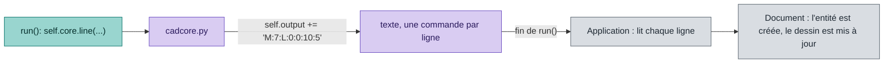

# Référence de l'API des scripts CAO

*English version: [CAD-SCRIPTS.en.md](CAD-SCRIPTS.en.md).*

Cette référence s'adresse à qui écrit un script CAO : un fichier Python qui crée de la géométrie (lignes, cercles, arcs) dans le dessin, à la position de la souris. Elle liste chaque méthode de la classe `Cadscript` et chaque appel du moteur, avec les arguments, le moment de l'appel et un exemple. Le fichier fourni `script/oblong.py` (un trou oblong, avec une boîte `tkinter`) est l'implémentation de référence. Les post-processeurs sont dans [POSTPROCESSOR.fr.md](POSTPROCESSOR.fr.md).

Contenu : installation, déroulement d'une exécution, méthodes de `Cadscript`, appels de dessin du moteur et un exemple minimal complet.

## 0. Conventions

### Fichiers et chargement

| Élément | Règle |
|---|---|
| Emplacement | le dossier `script` à côté de l'exécutable |
| Chargement | au démarrage, chaque fichier `.py` est copié dans `~/.openpostpro/script` et chargé depuis cet emplacement |
| Nom | le vôtre (`my_rectangle.py`) : la copie **écrase les fichiers de même nom** |
| Classe | le fichier définit une classe nommée `Cadscript` |
| Fichiers bibliothèque | un fichier `.py` sans la ligne `class Cadscript` est un module partagé par d'autres fichiers (comme le moteur) : il est importé, pas listé dans le menu |
| Lecture seule | un fichier fourni avec l'application n'est pas modifiable dans l'application : utilisez **Cloner** pour en faire une copie modifiable sous un autre nom et une autre description |
| Menu | Éditer (fichiers personnels seulement), Cloner, Ouvrir le dossier (le dossier de `~/.openpostpro`) |
| Éditeur | **Enregistrer** ou Ctrl+S écrit le fichier, **Compiler** vérifie la syntaxe et recharge le fichier. Une erreur Python est écrite dans le journal avec sa trace |
| Moteur | `cadcore.py` est le moteur. Il n'est jamais chargé comme script. Ne le modifiez pas |
| Erreurs | écrites dans `~/.openpostpro/openpostpro.log` |
| Python | 3.12 ou plus, installé avec « Add Python to PATH » (voir le README) |
| `tkinter` | écrivez `import tkinter` : `cadcore.py` indique déjà à Python où trouver les bibliothèques Tcl/Tk de l'installation |

### Qui appelle qui

```
OpenPostPro (C++)  ->  Cadcore (cadcore.py)  ->  Cadscript (votre fichier)
```

Le moteur se transmet à votre classe : c'est `self.core`, renseigné par `set_core()`. Votre classe dessine en appelant `self.core` ; le moteur collecte le dessin sous forme de texte et le renvoie à l'application quand `run()` se termine.

### Types et encodages

- Les coordonnées sont des nombres en unités du dessin (`float`).
- `cw` d'un arc est un booléen : `True` pour le sens horaire.
- Codes de langue : `en-us`, `en-uk`, `fr-fr`, `es-es`.

## 1. Déroulement d'une exécution

```
set_language(lang)    au chargement du script
set_core(core)        une fois
get_description() get_category()    pour construire le menu Scripts
get_property / set_property         chargement et valeurs sauvegardées
-- quand l'utilisateur lance le script --
core.mouse_x / mouse_y sont renseignés   position de la souris
run()                               le script dessine et peut ouvrir une fenêtre
-> le dessin renvoyé par le moteur est ajouté au document
```

Un fichier sans `class Cadscript` n'est pas un script : il est ignoré et absent du menu. Utilisez-le pour du code partagé entre plusieurs scripts (`import mes_outils`). Quand un script échoue, le journal donne la trace Python, avec le fichier et la ligne de l'erreur.

De la fonction Python au dessin : le script appelle le moteur, qui écrit des commandes courtes en texte, lues par l'application à la fin de `run()`.



Les commandes sont une par ligne : `M:id:L:x1:y1:x2:y2` (segment), `M:id:C:x:y:r` (cercle), `M:id:A:...` (arc), `D:id` (supprime), `G:texte` (journal), `Y:calque` (calque).


## 2. Méthodes de `Cadscript`

| Méthode | Arguments | Retour | Rôle |
|---|---|---|---|
| `set_language(value)` | `'en-us'`, `'en-uk'`, `'fr-fr'` ou `'es-es'` | rien | choisit le dictionnaire des textes de l'interface |
| `set_core(value)` | le moteur | rien | à mémoriser dans `self.core` ; ne pas modifier |
| `get_description()` | aucun | chaîne | nom affiché dans le menu Scripts |
| `get_category()` | aucun | chaîne | menu du menu Scripts : `'generation'`, `'geometry'`, `'modify'`, `'import'`, `'export'` ou `'examples'` (traduits par le moteur), ou un autre nom utilisé tel quel |
| `get_properties_count()` | aucun | nombre | nombre de paramètres du script |
| `get_property_description(index)` | indice depuis 0 | chaîne | libellé du paramètre |
| `get_property_key(index)` | indice depuis 0 | chaîne | optionnel : nom utilisé pour sauvegarder la valeur (par défaut : l'indice) |
| `use_properties()` | aucun | `bool` | optionnel : `False` si le script affiche sa propre fenêtre (défaut `True`) |
| `get_property(index)` | indice depuis 0 | `bool`, `int`, `float`, `str` ou `list` de `str` | valeur courante |
| `set_property(index, value)` | indice, valeur | rien | reçoit la valeur sauvegardée au démarrage, ou la valeur modifiée |
| `run()` | aucun | rien | crée la géométrie via `self.core` |

Si `get_properties_count()` renvoie plus de 0, OpenPostPro affiche la boîte de propriétés (mêmes contrôles que pour les post-processeurs, voir POSTPROCESSOR.fr.md section 4) quand le script est choisi. **Ok** envoie les valeurs par `set_property` puis exécute le script ; **Annuler** l'arrête. Les valeurs sont sauvegardées par script et redonnées à l'appel suivant. Renvoyez un nom stable dans `get_property_key` pour que l'ajout ou le déplacement d'une propriété ne mélange jamais les valeurs sauvegardées.

Un script peut aussi gérer sa propre fenêtre (par exemple `tkinter`, pour ouvrir un sélecteur de fichier) : renvoyez `False` dans `use_properties()` et aucune boîte n'est affichée ; `oblong.py` en est un exemple.

## 3. Appels du moteur (`self.core`)

### Position de la souris

| Attribut | Type | Rôle |
|---|---|---|
| `self.core.mouse_x` | `float` | X de la souris au lancement du script |
| `self.core.mouse_y` | `float` | Y de la souris au lancement du script |

À utiliser comme origine de la forme.

### Unité et sélection

| Attribut | Type | Rôle |
|---|---|---|
| `self.core.unit` | `str` | unité du document, `'mm'` ou `'inch'` : toutes les coordonnées sont dans cette unité |
| `self.core.selection` | `list` de `dict` | les formes sélectionnées quand le script est choisi (les usinages ne sont pas listés) |
| `self.core.drawing` | `list` de `dict` | toutes les formes du document, de tous les calques, au même format : pour les scripts qui exportent le dessin |

La sélection est lue quand le script est choisi dans le menu : elle ne change pas tant que la boîte de propriétés est ouverte. Elle est vide si rien n'est sélectionné. Chaque forme est un dictionnaire avec les clés `id` (numéro unique de la forme dans le document), `layer` (nom de son calque) et `type`, puis les clés de son type. Les points sont des tuples `(x, y)`.

| `type` | Autres clés |
|---|---|
| `'line'` | `p1`, `p2` |
| `'circle'` | `center`, `radius` |
| `'arc'` | `start`, `center`, `stop`, `cw` (`True` pour le sens horaire), `radius` |
| `'point'` | `p1` |
| `'ellipse'` | `center`, `major`, `minor`, `start`, `stop`, `angle` (angles en radians) |
| `'polyline'` | `points` (liste de tuples), `mode` (`'polyline'`, `'bspline'`, `'natural_cubic'`, `'lagrange'`, `'catmull'` ou `'bezier'`), `closed` |
| `'spline'` | `segments` (liste de dictionnaires), `closed` |
| `'text'` | `p1`, `text`, `family`, `height`, `inter`, `bold`, `italic` |

Les segments d'une spline sont des dictionnaires avec `type` (`'line'`, `'arc'` ou `'circle'`) et `point`. Un segment commence à son `point` et finit au `point` du suivant ; pour un arc ou un cercle, `center`, `radius` et `cw` donnent sa courbure.

```python
for shape in self.core.selection:
	if shape['type'] == 'line':
		x1, y1 = shape['p1']
		x2, y2 = shape['p2']
		self.core.circle((x1 + x2) / 2, (y1 + y2) / 2, 2.0)
```

`mark_middles.py` est un exemple complet de script qui lit la sélection.

### Journal et calques

| Appel | Effet |
|---|---|
| `self.core.log(text)` | écrit une ligne `Script: text` dans le journal de l'application (`print` n'est pas visible) |
| `self.core.set_layer(name)` | les formes ajoutées après cet appel vont dans le calque de ce nom, créé s'il n'existe pas (la création s'annule avec le script) ; sans nom, elles retournent dans le calque courant. Une forme modifiée garde son calque |

### Messages

| Appel | Effet |
|---|---|
| `self.core.message(text, title)` | affiche une boîte de message (`tkinter`) et attend que l'utilisateur la ferme ; `title` est facultatif (le nom du script par défaut). Si la boîte ne peut pas s'afficher, le script continue |

### Modifier et supprimer

| Appel | Effet |
|---|---|
| `self.core.modify_line(id, x1, y1, x2, y2)` | change les points d'une ligne |
| `self.core.modify_circle(id, x, y, r)` | change le centre et le rayon d'un cercle |
| `self.core.modify_arc(id, x1, y1, cx, cy, x2, y2, cw)` | change le début, le centre, la fin et le sens d'un arc |
| `self.core.modify_point(id, x, y)` | change un point |
| `self.core.modify_ellipse(id, cx, cy, major, minor, start, stop, angle)` | change une ellipse (`start`, `stop`, `angle` en radians, par défaut `0` et `2*pi` pour une ellipse entière, `0`) |
| `self.core.modify_polyline(id, points, mode)` | change les points (liste de `(x, y)`) et le mode d'une polyligne |
| `self.core.modify_spline(id, segments)` | change les segments d'une spline (liste de dictionnaires, même format que la sélection) |
| `self.core.modify_text(id, x, y, text, height, family, bold, italic, inter)` | change un texte |
| `self.core.remove(id)` | supprime une forme |

`id` est la clé `id` d'une forme de `self.core.selection`. Une modification ne change que les paramètres : une ligne reste une ligne, et la forme garde son `id`, son calque et ses usinages. Appliquer `modify_circle` à l'id d'une ligne est refusé et écrit dans le log. Supprimer une forme ne supprime pas les usinages qui l'utilisent.

Tous les changements, nouvelles formes comprises, s'annulent en une seule fois. `scale_circles.py` en est un exemple, tout comme `fillet.py` et `chamfer.py` : ils arrondissent ou coupent les coins des lignes, des splines de lignes et des polylignes sélectionnées. `chamfer.py` réutilise le code de `fillet.py` (`import fillet`), ce qui montre comment des scripts peuvent partager du code.

### Dessin

| Appel | Arguments | Effet |
|---|---|---|
| `self.core.line(x1, y1, x2, y2)` | début, fin | ajoute une ligne |
| `self.core.circle(x, y, r)` | centre, rayon | ajoute un cercle |
| `self.core.arc(x1, y1, cx, cy, x2, y2, cw)` | début, centre, fin, sens | ajoute un arc de `(x1, y1)` à `(x2, y2)` autour de `(cx, cy)` ; `cw` vaut `True` pour le sens horaire |
| `self.core.point(x, y)` | position | ajoute un point |
| `self.core.ellipse(cx, cy, major, minor, start, stop, angle)` | centre, axes, plage, orientation | ajoute une ellipse ; `start`, `stop` et `angle` sont en radians et facultatifs (ellipse entière, sans rotation) |
| `self.core.polyline(points, mode)` | liste de `(x, y)`, mode | ajoute une polyligne ; `mode` vaut `'polyline'` (défaut), `'bspline'`, `'natural_cubic'`, `'lagrange'`, `'catmull'` ou `'bezier'` ; répétez le premier point pour la fermer |
| `self.core.spline(segments)` | liste de dictionnaires | ajoute une spline : chaque segment a `type` (`'line'`, `'arc'` ou `'circle'`) et `point`, et pour un arc `center`, `radius`, `cw` (voir la sélection) |
| `self.core.text(x, y, text, height, family, bold, italic, inter)` | position, texte, police | ajoute un texte (défauts : hauteur `10`, famille `'Arial'`, `bold` et `italic` à `False`, `inter` à `0`) |
| `self.core.append_output(text)` | texte brut | ajoute du texte à la sortie du dessin (avancé) |

Le moteur écrit une ligne de texte par élément, dans ce format :

| Élément | Texte |
|---|---|
| ligne | `L:x1:y1:x2:y2` |
| cercle | `C:x:y:r` |
| arc | `A:x1:y1:cx:cy:x2:y2:clock` où `clock` vaut `1` pour le sens horaire, `0` sinon |
| point | `P:x:y` |
| ellipse | `E:cx:cy:major:minor:start:stop:angle` |
| polyligne | `PL:mode:x1:y1:x2:y2:...` |
| spline | `S:` puis les segments `L:x:y` ou `A:x:y:cx:cy:r:clock` (`C:` pour un cercle) |
| texte | `T:x:y:height:inter:bold:italic:family:text` (le texte peut contenir `:`) |
| modification | `M:id:` suivi du texte de l'élément, par exemple `M:12:L:x1:y1:x2:y2` |
| suppression | `D:id` |

`append_output` permet à un script d'écrire lui-même de telles lignes. La géométrie est ajoutée au dessin quand `run()` se termine.

## 4. Exemple minimal complet

Enregistrez sous `script/my_rectangle.py`. Il n'a pas de fenêtre et dessine à partir de ses deux propriétés :

```python
class Cadscript:
	def __init__(self):
		self.width = 100.0
		self.height = 50.0
		self.en_us = {'description': 'Rectangle', 'width': 'Width', 'height': 'Height'}
		self.fr_fr = {'description': 'Rectangle', 'width': 'Largeur', 'height': 'Hauteur'}
		self.es_es = {'description': 'Rectangulo', 'width': 'Ancho', 'height': 'Alto'}
		self.Language = {'en-us': self.en_us, 'fr-fr': self.fr_fr, 'es-es': self.es_es}

	def set_language(self, value):
		self.lang = self.Language.get(value, self.en_us)   # unknown language: English

	def set_core(self, value):
		self.core = value

	def get_description(self):
		return self.lang['description']

	def get_category(self):
		return 'CAD'

	def get_properties_count(self):
		return 2

	def get_property_description(self, index):
		return self.lang['width'] if index == 0 else self.lang['height']

	def get_property(self, index):
		return self.width if index == 0 else self.height

	def set_property(self, index, val):
		if index == 0:
			self.width = float(val)
		else:
			self.height = float(val)

	def run(self):
		x = self.core.mouse_x
		y = self.core.mouse_y
		w = self.width
		h = self.height
		self.core.line(x, y, x + w, y)
		self.core.line(x + w, y, x + w, y + h)
		self.core.line(x + w, y + h, x, y + h)
		self.core.line(x, y + h, x, y)
```

Pour un script avec sa propre fenêtre de saisie, voir `script/oblong.py` : il construit une boîte `tkinter` dans `run()`, lit les valeurs, puis appelle `compute()` pour produire lignes et arcs.

## 5. Bibliothèque de géométrie (`geom`)

`geom.py` est un fichier bibliothèque (sans `class Cadscript`) : écrivez `import geom`. Les points sont des tuples `(x, y)`, les angles sont en degrés (sens anti-horaire depuis X). Les fonctions qui peuvent échouer renvoient `None` ou une liste vide.

| Groupe | Fonctions |
|---|---|
| Nombres | `EPS`, `almost_equal`, `normalize_angle` |
| Vecteurs | `add`, `sub`, `scale`, `dot`, `cross`, `length`, `distance`, `same`, `normalize`, `lerp`, `angle`, `angle_between`, `rotate(p, center, a)`, `mirror(p, p1, p2)` |
| Droites | `line_intersection`, `segment_intersection`, `project_on_line`, `point_segment_distance`, `offset_line(p1, p2, d)` (d positif = à gauche du sens) |
| Cercles, arcs | `arc_point`, `circle_from_3_points`, `arc_angles(center, start, end, cw)` (début, fin, balayage signé), `arc_length`, `circle_line_intersection`, `circle_circle_intersection`, `tangent_points` |
| Polygones | `bounding_box`, `polygon_area` (signée), `is_ccw`, `is_closed`, `polyline_length`, `offset_polyline(points, d, closed)` (coins vifs) |

Exemple : `geom.rotate((10, 0), (0, 0), 90)` renvoie `(0.0, 10.0)`.

## 6. Scripts d'import et d'export

Quatre scripts lisent ou écrivent d'autres formats de fichier. Le fichier n'est pas demandé dans une boîte de propriétés : quand son nom est vide, ils ouvrent une boîte de fichier (`tkinter`). La logique est dans des bibliothèques, pour pouvoir la tester sans l'application.

| Fichier | Rôle |
|---|---|
| `svg_import.py` | importe un fichier SVG. Le coin inférieur gauche de la page est à la souris, la taille est en millimètres (convertie en pouces si le document est en pouces), les calques d'Inkscape deviennent des calques |
| `svg_export.py` | écrit la sélection, ou tout le dessin si rien n'est sélectionné (`self.core.drawing`), dans un fichier SVG en millimètres |
| `gerber_import.py` | importe un fichier Gerber (RS-274X) ou Excellon : pastilles, pistes, régions et trous. *Pistes en contours* : chaque piste devient une forme fermée de sa largeur |
| `svgparse.py` | bibliothèque : `parse(text, scale)` donne une liste de formes (dictionnaires) à partir d'un texte SVG |
| `gerberparse.py` | bibliothèque : `parse(text)` lit un texte Gerber ou Excellon, `convert(parsed, outline, name)` donne les formes |
| `drawshapes.py` | bibliothèque : `draw(core, shapes, x, y)` dessine ces formes avec les appels du moteur, `scale(shapes, k)` les multiplie |

**Import SVG** : `path` (M L H V C S Q T A Z, absolu et relatif), `rect` (coins arrondis aussi), `circle`, `ellipse`, `line`, `polyline`, `polygon`, `text`, `use`, les groupes et `transform`. Les courbes sont découpées en segments de 0,4 mm ; un chemin fait seulement de lignes et d'arcs reste exact (une spline). Les couleurs et les épaisseurs de trait sont ignorées, les formes `display:none` sont sautées.

**Export SVG** : les polylignes Bézier et Catmull-Rom sont écrites en courbes cubiques ; les autres modes de courbe (B-spline, cubique naturelle, Lagrange) sont écrits par leurs points de contrôle, et le journal dit combien.

**Gerber** : les ouvertures C, R, O et P, les flashs, les pistes (droites et arcs, en mode quadrant simple ou multiple), les régions (`G36`/`G37`), la polarité, les unités et le format des nombres. Les formes de polarité claire vont dans le calque `<nom>_clear` : elles ne sont pas soustraites des autres. Les formes qui se chevauchent ne sont pas fusionnées : utilisez les opérations booléennes de l'application sur les formes fermées. Les ouvertures macro (`AM`) ne sont pas lues, le journal les compte.

**Excellon** : les outils, les trous et les rainures (`G85`), métrique ou pouce, avec ou sans point décimal.
