# OpenPostPro user manual

*Version française : [MANUAL.fr.md](MANUAL.fr.md).*

OpenPostPro is a CAD/CAM program: you draw a part (or import a drawing), prepare the machining operations, generate the machine program with a post-processor, then check it in 3D before sending it. This manual follows that path, with an example project from start to end. The detailed references for programming in Python are the guides listed in chapter 12.

The screenshots come from version 0.6, with the example project `examples/plaque.en.opp` (open it with **File / Open** to follow along).

## Contents

1. [The path from drawing to machine](#1-the-path-from-drawing-to-machine)
2. [First start and layout of the interface](#2-first-start-and-layout-of-the-interface)
3. [The menus](#3-the-menus)
4. [Drawing](#4-drawing)
5. [Machines and tools](#5-machines-and-tools)
6. [The operations](#6-the-operations)
7. [The types of machining](#7-the-types-of-machining)
8. [The post-processor](#8-the-post-processor)
9. [The scripts](#9-the-scripts)
10. [The simulator](#10-the-simulator)
11. [Step-by-step examples](#11-step-by-step-examples)
12. [Going further](#12-going-further)

## 1. The path from drawing to machine

1. **Draw**: sketch the shapes, or import a DXF, SVG, Gerber or Excellon file, or run a CAD script.
2. **Prepare the machine and the tools**: choose the machine (table, zero, direction of the axes) and the tools (diameter, feed rates).
3. **Create the operations**: an operation is a tool with its depth, pass depth and feed rates; you add machining to it (follow a line, pocket, drilling...).
4. **Generate** the output file with the post-processor of your controller.
5. **Simulate** the file on a block of material in 3D, and fix what you see.
6. **Send** the file to the machine.

The diagram shows who does what: green boxes are Python you can write, purple ones are provided Python (the engines), grey ones are the program itself.

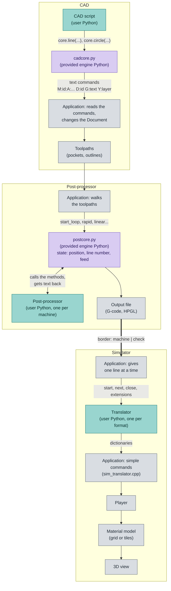

The output file is the border between the machine (the post-processor) and the check (the simulator).

### The example project

The whole manual uses a 400 × 200 mm plate, machined on a 600 × 400 mm router: an outline with rounded corners, four mounting holes, a rosette (two engraved rings, a 12-point star hollowed out as a pocket) and two slots. The shapes are in five **layers** (Outline, Holes, Rings, Star, Slots) and machined by five **operations**:

| Operation | Tool | Depth | Machining |
|---|---|---|---|
| Star pocket | T2, 3 mm end mill | −3 mm | pocket with offsets |
| Rings engraving | T1, 1 mm end mill | −0.5 mm | follow the line, centered |
| Slots | T2, 3 mm end mill | −3 mm | zigzag pocket |
| Holes | T2, 3 mm end mill | −4 mm | four drillings |
| Cut out | T3, 6 mm end mill | −8 mm | follow the line on the outside, four tabs |

## 2. First start and layout of the interface

At the very first start, a **Welcome** window asks for the **language** of the interface and the default **unit** of new documents (millimetre or inch). The interface changes language as soon as you choose, and **Ok** confirms. Both choices can be changed later in **Tools / Preferences**.

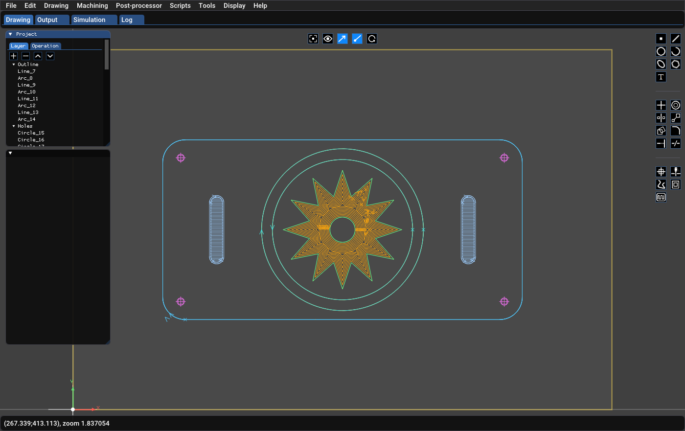

The screen is made of:

- **The menu bar** at the top (chapter 3).
- **The module tabs**, under the menu bar: **Drawing** (CAD and CAM), **Output** (the text of the generated program), **Simulation** (the 3D simulation) and **Log** (messages and errors). The log can also be shown at the bottom of the screen (**Display / Log**).
- **The Project window**, top left, with two tabs: **Layer** (the layers and their shapes) and **Operation** (the operations and their machining).
- **The properties window**, just below: it shows the settings of what is selected in the project or in the drawing. Its title is the name of the item.
- **The drawing area**, in the middle. Left button: select and draw; right button: move the view; wheel: zoom. The yellow rectangle is the table of the chosen machine, and the mark at the bottom left is the zero of the machine.
- **The icon bars**: at the top center (display) and on the right (drawing, modification, machining), see below.
- **The status bar**, at the bottom: position of the mouse in the drawing (in the unit of the document) and zoom level.

### The Project window

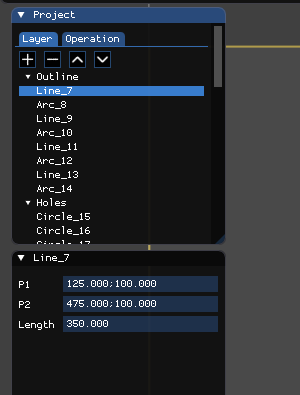

The **Layer** tab lists the layers (the triangle folds or unfolds) and their shapes. A click selects a shape and its properties appear below; **Ctrl-click** adds a shape to the selection and **Shift-click** removes one. The four buttons above the list are **+** (add), **−** (remove), **▲** and **▼** (move up and down in the list). A layer has a name, a colour, a visible state and a locked state: the shapes of a locked layer cannot be moved, edited, deleted, cut or extended any more, but the magnet still snaps to them.

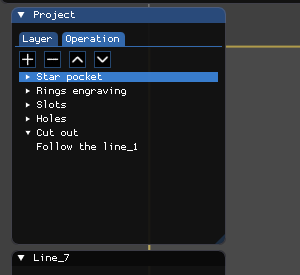

The **Operation** tab lists the operations and, under each, its machining (pocket, follow the line, drilling...). The buttons **+**, **−**, **▲** and **▼** add, remove and reorder the operations; **the order of the operations is the order of the program**.

### The icon bars


The top bar acts on the display: **fit the drawing** in the window (Home key), **show or hide all the toolpaths**, show the machining **direction**, show their **start**, and **update** the texts linked to a curve then the toolpaths from their shapes (useful after a change in the drawing).

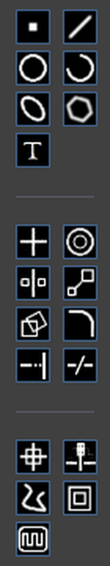

The right column has three series of icons, separated by a line:

1. **Create**: point, line, circle, arc, ellipse, polyline, text.
2. **Modify**: move the origin, offset, symmetry, scale, rotation, chamfer / fillet, extend, cut.
3. **Machine**: move to position, drilling, follow the line, go around the line, pocket machining.

A greyed-out icon is not available: for example, the current operation uses a torch, which neither drills nor clears a pocket. Leave the mouse on an icon for a moment to show its name.

## 3. The menus

### File

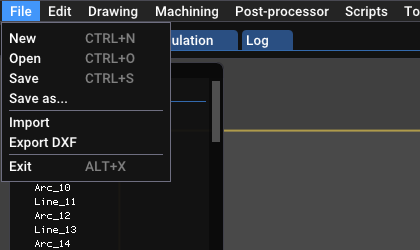

**New**, **Open** and **Save** (`.opp` documents); **Import** opens a DXF file; **Export DXF** writes the shapes (only the selection, if there is one). Import and export of SVG, Gerber and Excellon are scripts (chapter 9).

### Edit

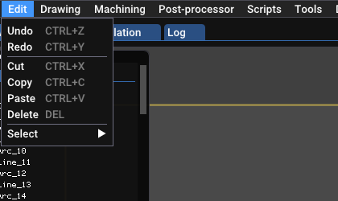

**Undo / Redo** (Ctrl+Z, Ctrl+Y), **Cut / Copy / Paste / Delete**. The **Select** submenu has: *Select all* (Ctrl+A), *Objects of the current layer*, *The layer* (chooses a layer by name), *Contour* (selects every shape connected to the selection) and *Invert selection*. These menus save you from drawing a selection rectangle in a busy drawing.

### Drawing

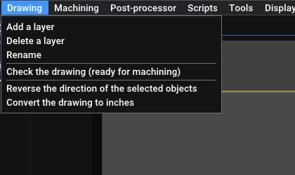

Add, delete and rename a layer; **Check the drawing** (see chapter 4); reverse the direction of the selected objects; convert the whole drawing to inches (or millimetres). With a selection, the menu also offers cutting at intersections, the boolean operations (union, intersection, subtraction), conversion to a spline, and linking a text to a curve.

### Machining

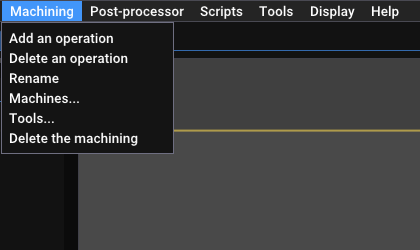

Add, delete and rename an **operation**; open the table of **machines** and the table of **tools** (chapter 5); delete the selected machining.

### Post-processor

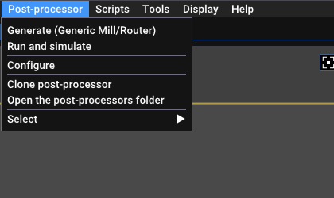

**Generate** writes the output file with the chosen post-processor (its name is in brackets); **Run and simulate** generates it and plays it in the simulator; **Configure** opens its settings; **Clone** makes an editable copy; **Open the folder**; **Select** chooses the post-processor by category. See chapter 8.

### Scripts

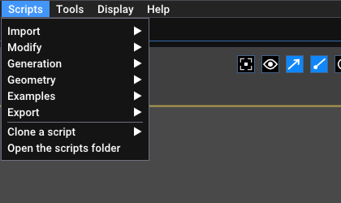

The delivered scripts are sorted by category: *Import*, *Modify*, *Generation*, *Geometry*, *Examples*, *Export*. **Clone a script** makes an editable copy. See chapter 9.

### Tools, Display, Help

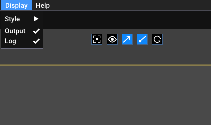

**Tools / Preferences** opens the preferences (language, unit, look). **Display** chooses the style of the interface (classic, dark, light) and shows or hides the Output and Log windows. **Help / About** gives the version and the build date.

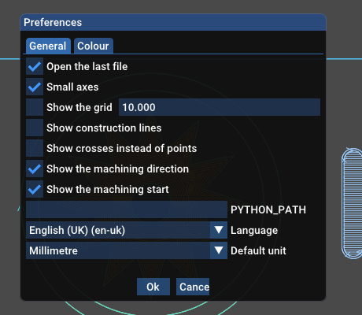

In the preferences: open the last file at start, small axes, grid, construction lines, crosses instead of points, display of the machining direction and start, folder of Python (`PYTHON_PATH`, if Python is not in the PATH), language and default unit; the **Colour** tab sets the colours of the drawing, the toolpaths and the simulation.

## 4. Drawing

### Choosing and entering

Click an icon of the right column, then click in the drawing. The status bar gives the position of the mouse. A **magnet** snaps the mouse to the remarkable points of the drawing (ends, centers, intersections): a small square shows the point aimed at. Numeric values are typed in the properties window, which shows the shape as soon as it exists. **Esc** cancels the creation in progress.

### The shapes

| Icon | Shape | How to create it |
|---|---|---|
| ▪ | **Point** | one click |
| ╱ | **Line** | two clicks: start and end |
| ◯ | **Circle** | the center, then a point of the circle |
| ◜ | **Arc** | *by the centre* or *by three points* (chosen in the window which opens) |
| ⬭ | **Ellipse** | a few clicks, then the values in the properties (center, major and minor axes, angles) |
| ⬡ | **Polyline** | a series of clicks; the **space bar** or the *Add* button confirms |
| T | **Text** | one click, then the text and the font in the properties |

A text has a font, a height, bold and italic, a position relative to the line (above, aligned, below), a spacing between letters and a mirror. It can **follow a curve** (line, arc, circle or a chain of connected shapes): select the text then **Drawing / Link the text to the object** and click the curve; the start of the text is set with a slider.

### The properties of a shape

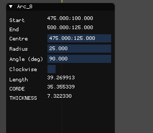

Each shape shows its sizes as numeric fields you can edit: a **line** has its two points P1, P2 and its length; a **circle** its center, radius and diameter; an **arc** its start, end, center, radius, angle, direction, length and chord. Points are written `x;y`. When you change the radius of a circle, or the diameter, the other value follows.

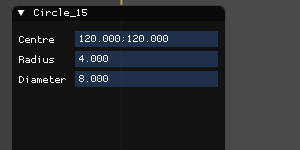

A selection of several shapes shows the properties of each, one under the other.

### Modifying

The icons of the second series act on the selection:

- **Move the origin**: chooses the point which becomes the zero of the drawing.
- **Offset**: copies the selection at a given distance (on each side).
- **Symmetry**: mirror about an axis you point out.
- **Scale**: enlarges or reduces by a factor.
- **Rotation**: turns by the angle you enter around a point.
- **Chamfer / fillet**: rounds or cuts a corner between two lines (the radius is set in the window which opens).
- **Extend**: lengthens a line or an arc, from the end nearest to the mouse, up to the nearest shape; the result is shown under the mouse before the click.
- **Cut**: cuts a line, arc, circle, polyline or ellipse at the clicked point (the magnet stays on) or at the crossing of the shapes under the click.

### Checking the drawing

**Drawing / Check the drawing** looks for problems which get in the way of machining and marks them on the drawing: shapes of **zero length**, **duplicate** shapes and **free ends** (open contours). A "follow the line" or "pocket" machining expects closed contours. The log says "the drawing is ready for machining" when nothing is found; *Clear the check markers* removes them.

### Import and export

**File / Import** reads a DXF: lines, points, circles, arcs, ellipses, polylines, splines (B-splines and NURBS), texts and blocks (with position, scale and rotation). Ends less than 0.01 apart are joined. **File / Export DXF** writes an AutoCAD R12 DXF. The scripts of **Scripts / Import** and **Export** read and write SVG, Gerber (RS-274X) and Excellon.

## 5. Machines and tools

### The machines

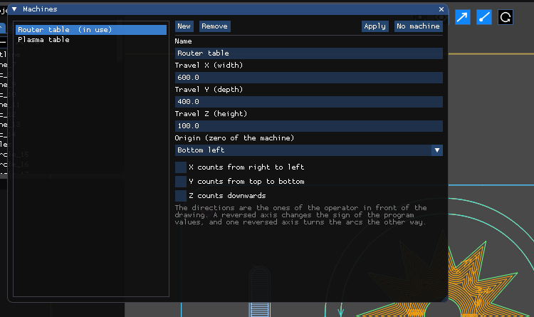

**Machining / Machines...** opens the table of machines: the list on the left, the settings of the chosen machine on the right. A machine gives:

- the **travel** in X, Y and Z: the surface of the table is drawn under the drawing (yellow rectangle), and a toolpath which leaves it is flagged "Out of the area of the machine";
- the **origin** (the zero of the machine): bottom left, bottom right, top left, top right or center;
- the **direction of the axes**: "X counts from right to left", "Y counts from top to bottom", "Z counts downwards". The directions are the ones of the operator in front of the drawing. A reversed axis changes the sign of the program values; one reversed axis turns the arcs the other way, and the post-processor and the simulator take it into account.

**Apply** uses the machine for the document; **No machine** removes the machine from the document. The machine is saved in the document.

### The tools

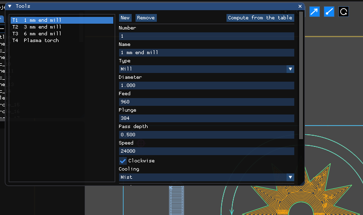

**Machining / Tools...** opens the table of tools: the list (T1, T2...) and the settings of the chosen tool:

| Field | Role |
|---|---|
| Number | the number `Tn` of the program; unique |
| Name | free text |
| Type | end mill, plasma torch, water jet, wire EDM |
| Diameter | diameter of the cutter, or **kerf width** of a torch |
| Feed, Plunge | cutting feed and plunge feed (mm/min) |
| Pass depth | depth removed at each pass |
| Speed, Clockwise, Cooling | spindle and coolant (cutter only) |
| Teeth, Material | for **Compute from the table**: the program proposes speed and feed from the diameter, the number of teeth and the material (indicative values for carbide cutters, to adjust) |

Changes are saved at once. The details (torches, oblique plunge, cutting table) are in [TOOLS-MACHINES.en.md](TOOLS-MACHINES.en.md).

## 6. The operations

An **operation** gathers the settings of one tool and the machining which uses it. Create one with **Machining / Add an operation**, then choose it in the **Operation** tab: its properties appear.

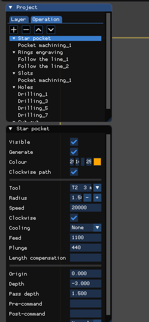

| Setting | Effect |
|---|---|
| Visible | shows or hides the toolpaths of the operation in the drawing |
| Generate | when checked, the operation is written in the program; unchecked, it is skipped |
| Colour | colour of the toolpaths in the drawing |
| Clockwise path | direction of the closed contours (clockwise or counter-clockwise) |
| Tool | the tool of the table; its settings are copied into the operation, which you can then edit |
| Radius | radius of the tool (used by offsets, pockets and compensation) |
| Speed, Clockwise | spindle speed and direction |
| Cooling | none, flood or mist |
| Feed, Plunge | cutting feed, plunge feed |
| Length compensation | number of the length offset (leave empty otherwise) |
| Origin | Z height of the surface of the material |
| Depth | final depth (negative, under the origin) |
| Pass depth | depth removed at each pass: the depth is reached in several passes |
| Pre-command, Post-command | free text written before and after the operation (for example M8 / M9) |
| Start | where the closed paths begin: normal, or shifted |

The machining of an operation is done in the order of the list. **Machining / Delete the machining** removes the selected one.

### Creating a machining

1. Choose the operation in the **Operation** tab.
2. Select the shapes (a click, a rectangle, or **Edit / Select / The layer**).
3. Click the icon of the machining in the right column.

The machining appears under the operation, with its own properties. The shapes of the drawing can be changed afterwards: the *update the toolpaths* button of the top bar computes them again.

## 7. The types of machining

### Follow the line

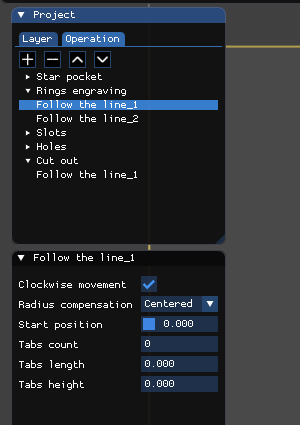

Makes the tool follow the selected shapes. A "follow the line" machining is created **for each shape or chain of connected shapes**: the two rings of the example give two machining. Settings:

- **Clockwise movement**: direction of travel.
- **Radius compensation**: *Centered* (the axis of the tool is on the line, for engraving for example), *Outside* or *Inside* (the tool stays outside or inside the shape: this is cutting out a contour). The side is deduced from the direction of travel. The post-processor writes G41 / G42, and for a torch the kerf is compensated the same way.
- **Start position**: where the path begins on the shape.
- **Entry and exit**: a line or a quarter circle, to enter and leave the material without marking the part.

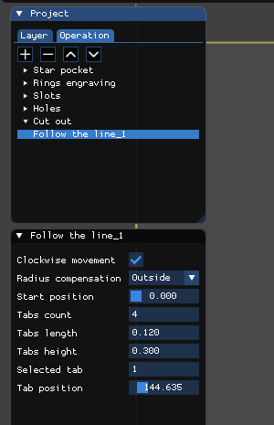

On a closed contour, the **tabs** (holding bridges) keep the part in place so that it does not move at the end of the cut: *Tabs count*, *Length*, *Height*, then *Selected tab* and its *position*, which you move with a slider. The tool rises to the height of the tab and goes down again after it. In the program, the cut-out of the plate reads:

```
(TOOLPATH [Follow the line_1])
G41
F530
G1Z-8
F1326
G2X100Y125J25
G1Y230.305054
Z-7.7
Y230.425049
Z-8
```

`G41` is the radius compensation, `Z-7.7` the passage over a tab (height 0.3 mm).

### Pocket machining

Clears the inside of a closed shape, **islands** respected (the central disc of the star stays in place). Three strategies, chosen in *Mode*:

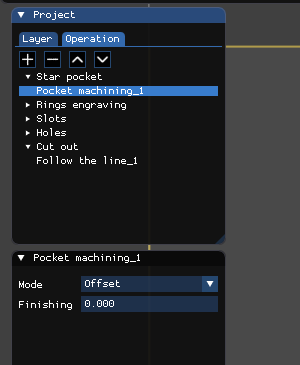

| Mode | Principle |
|---|---|
| **Zigzag** | parallel lines inside the shape, at any angle; settings: *Stepover* (distance between two lines), *Angle*, and *Contours* (with or without going along the contour) |
| **Offset** | concentric contours which shrink toward the center |
| **Spiral** | a spiral inward or outward |

*Finishing* adds a last finishing pass along the contour, machined last. A pocket uses the settings of the operation (radius, depth, pass depth): a 3 mm deep pocket with a 1.5 mm pass depth is made in two passes. The icon is greyed out with a torch.

### Drilling

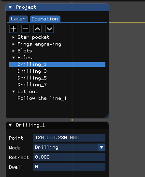

Click the **drilling** icon, then click the points to drill in the drawing (the magnet aims at the centers of circles); each click creates a drilling. Settings: the **point**, the **mode** (*Manual*, *Drilling*, *Peck drilling*, *Tapping*, *Boring*), the **retract** (height of withdrawal) and the **dwell**. The modes use canned cycles of the program:

```
(TOOLPATH [Drilling_1])
G0Y280
G81G99Z-4R0
```

Press **Esc** after the last point to leave the creation of drillings.

### Move to position

Adds to the operation a positioning move to a point you click.

### Go around the line and spiral

*Go around the line* creates interior or exterior offsets of the chosen shape; *spiral* creates spiral toolpaths. Neither is illustrated here: try them on the example project and look at their properties.

## 8. The post-processor

The **post-processor** turns the machining into a program for your controller. It is written in Python and is edited without touching the program (see [POSTPROCESSOR.en.md](POSTPROCESSOR.en.md)).

### Choosing

**Post-processor / Select** lists the post-processors by category: *Mill / Router* (generic milling), *Plasma* (generic plasma cutting) and variants for controllers: **Mach3** (`.tap` file, absolute arc centers with `G90.1`), **Num 1060** (spaces between the words, no `G64`, dwell with `F`), **Burny 2.5** (every arc gives `X Y I J`) for milling and for plasma, and **HPGL** for plotters and vinyl cutters (the tool number is the pen). They are starting points: read the output and adapt it to your machine before use.

### Configuring

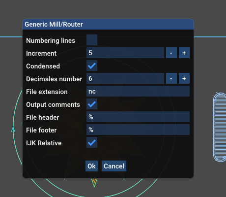

**Post-processor / Configure** opens the settings of the chosen post-processor. For generic milling:

| Setting | Effect on the file |
|---|---|
| Numbering lines | adds an `N` number at the start of each line |
| Increment | step between two numbers (`N5`, `N10`, ...) |
| Condensed | no space between the words: `G1X10Y5` instead of `G1 X10 Y5` |
| Decimals number | maximum number of decimals of the written numbers |
| File extension | extension of the output file (`nc`, `tap`...) |
| Output comments | writes the `(OPERATION [...])` and `(TOOLPATH [...])` lines |
| File header, File footer | characters written at the start and end of the file (often `%`) |
| IJK Relative | the center of the arcs is given relative to the start (checked), or absolute |

Plasma post-processors add torch settings (ignition commands, pierce time, reference, Z axis handling). The settings are kept from one session to the next.

### Generating

**Post-processor / Generate** writes the file at the output location of the document (its extension comes from the *File extension* setting), and the **Output** tab shows its text:

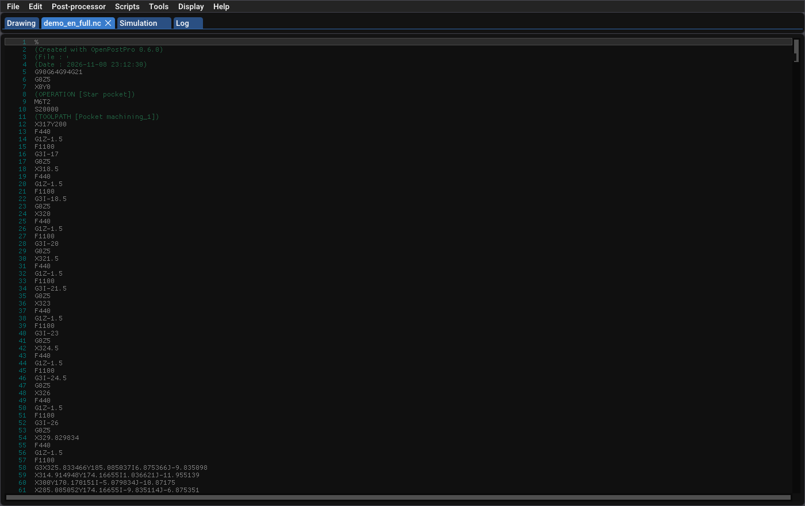

The program of the example starts like this:

```
%
(Created with OpenPostPro 0.6.0)
G90G64G94G21
G0Z5
X0Y0
(OPERATION [Star pocket])
M6T2
S20000
(TOOLPATH [Pocket machining_1])
X317Y200
F440
G1Z-1.5
F1100
G3I-17
```

You can read the three levels: the operation (`M6T2`: tool 2; `S20000`: the spindle), the machining (the comment), then the moves. The operations are written in the order of the list of the **Operation** tab, and the tool is changed at each operation.

**Post-processor / Clone** copies a delivered (read-only) post-processor under a new name so you can adapt it to your controller with the built-in editor (**Compile** checks the syntax).

## 9. The scripts

A **script** is a small Python program which creates or modifies shapes in the drawing: a rectangle, a gear, an array, a fillet, a bitmap tracing... The delivered scripts are in the **Scripts** menu:

- **Generation**: rectangle, hexagon, star, oblong hole, wheel spokes, exterior spur gear, airfoil from a coordinate file, grid of holes.
- **Modify**: linear and polar array of the selection, chamfer, fillet.
- **Geometry**: center of gravity, scale of circles.
- **Import / Export**: SVG, Gerber and Excellon (pads, tracks, regions, holes), bitmap tracing with Potrace.
- **Examples**: small scripts to learn from (middle of lines, rectangle...).

To run a script, choose it in the menu; a window asks for its parameters (for example the width and height of a rectangle), and **Ok** runs it. The script receives the selection, the position of the mouse and the unit of the document; the shape is created at the position of the mouse. **Each run is undone in a single step** (Ctrl+Z).

The delivered scripts are read-only: **Scripts / Clone a script** makes an editable copy, with the built-in editor (**Save**, **Compile**). A Python error is written in the log with the traceback and the line. To write a script, see [CAD-SCRIPTS.en.md](CAD-SCRIPTS.en.md).

## 10. The simulator

The **simulator** plays the program on a block of material in 3D, before it is sent to the machine. **Post-processor / Run and simulate** generates the program of the document and opens it in the **Simulation** tab; **Current program** reloads the output of the document, **Open...** loads any G-code file (which can also be dropped on the window).

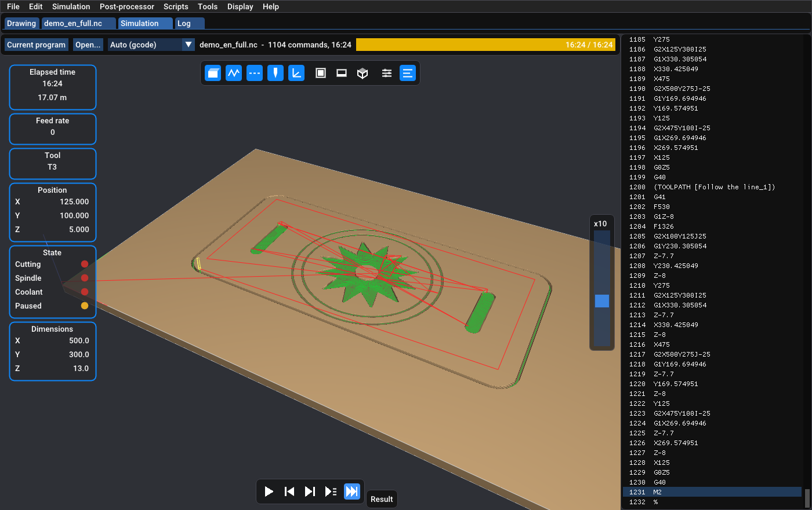

The screen reads as follows:

- **The 3D view**, in the middle: the block of material, the feed moves (green) and rapid moves (red), the tool. Left button: turn; right button: move; wheel: zoom.
- **The cards**, on the left: elapsed time and length travelled, feed rate, tool, X Y Z position, state (cutting, spindle, coolant, paused) and dimensions of the machined area.
- **The program**, on the right: the line being played is in colour (red for an error, yellow for a warning); a click on a line goes to that line.
- **The player buttons**, at the bottom: play / pause (space bar), back to the start, **step** (up to the end of the next move), **line** (up to the end of the next line) and **result** (goes to the end of the program). The slider on the right sets the speed, from ×1 (the real speed of the machine) to ×500, or full speed.
- **The top bar**: the translator (*Auto*, or a forced translator), the name of the program, the number of commands, and the total time.

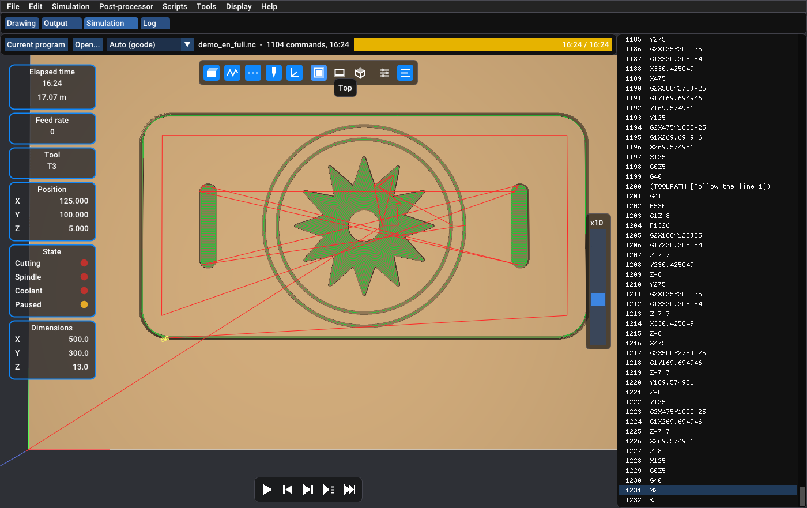

The icons of the bar above show or hide the **material**, the **feed** and **rapid** moves, the **tool** and the **axes**, and choose the **top**, **front** or **iso** view.

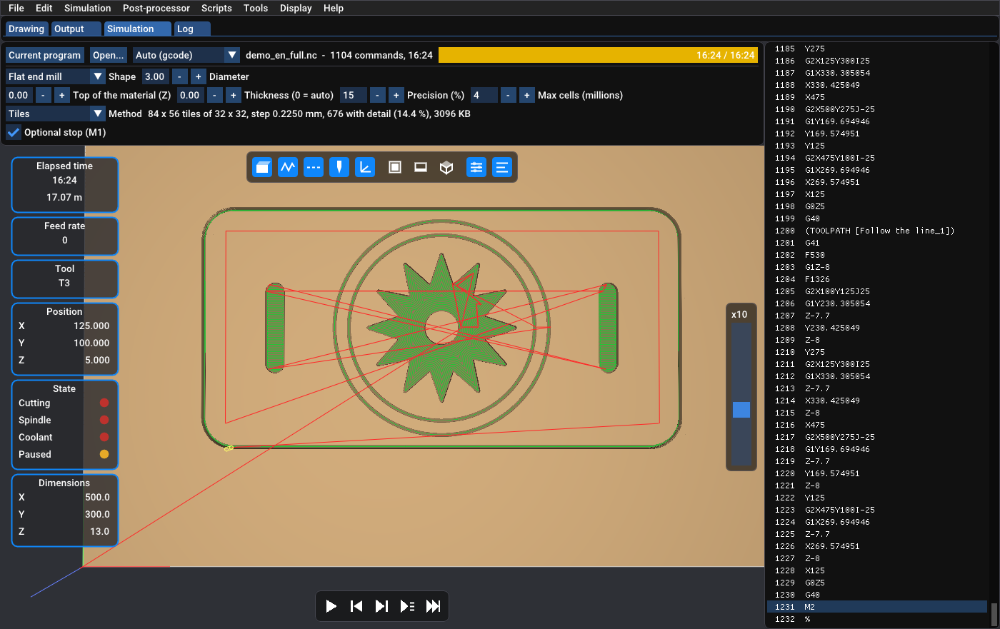

The last group of icons opens the **settings**: the shape of the tool (flat end mill, ball nose, bull nose, V bit, plasma torch), its diameter, the corner radius of a bull nose or the angle of a V bit, the top of the material (Z), the thickness (0 = automatic), the precision as a percent of the radius of the tool, and the optional stop `M1`. Changing a setting makes the block again and plays the program again.

What the simulator checks and does not check: it plays the programmed path (the path as the controller will do it), it detects the errors and warnings of the program and computes the machining time from the feed rates. It is not a complete model of the machine: the cutter radius compensation (G41 / G42) is not applied, and the axes A, B, C are ignored. The translator (Python) which reads the program is chosen from the extension of the file, or forced in the list; see [SIMULATOR.en.md](SIMULATOR.en.md) to write your own.

## 11. Step-by-step examples

Three example projects complete the plate: `examples/medal.en.opp`, `examples/sign.en.opp` and `examples/tray.en.opp` (open them with **File / Open**). They show together **text pockets**, **text around a circle**, **tabs**, **shifted starts** and **pockets with islands**. They use the same router table and the same tools as the plate.

### Example A: a medal, text around a circle

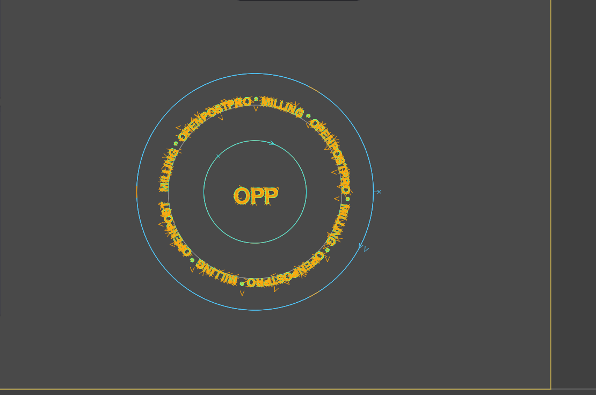

The drawing has four layers: **Edge** (the outer circle, which will be cut out), **Guide** (the grey circle, radius 88 mm, which the text wraps around), **Ring** (the engraved circle in the middle) and **Text** (the round text and the central text "OPP").

**1. The text around the circle.**

1. Create the guide circle, then a text with the **T** tool (Arial, bold, height 16 mm).
2. Select the text, choose **Drawing / Link the text to the object** (or the button of its properties) and click the guide circle. The text follows the curve; its letters keep their size.
3. In the properties of the text, **Position** chooses the side: *Above* puts the letters outside the circle, *Below* inside. **Start** moves the start of the text along the curve, **Spacing** spreads the letters. On a closed curve the text goes round; on an open curve it goes on in a straight line past the end.
4. The text follows its curve when it is moved with the mouse or when the origin or the unit is changed; in the other cases, the *update* button of the top bar reads the curve again. A text shorter than the circle leaves a gap: the example repeats its pattern to go all the way round.

**2. The text pockets.** Create the operation *Text pockets* (tool T1, 1 mm end mill, depth −0.8 mm). Select both texts (**Edit / Select / The layer / Text**), then the pocket icon, mode **Zigzag**.

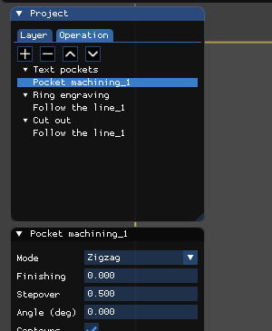

The letters are hollowed out, keeping their outlines: the tool must be **smaller than the strokes of the letters**, otherwise the letters are not cleared. With a 1 mm cutter, a 16 mm high text is cleared without trouble.

**3. A shifted start.** The operation *Ring engraving* follows the central circle (*follow the line*, *Centered*). A circle has no natural beginning: the **start** is the place where the tool goes down. The *Start position* moves it along the contour with a slider; here it is shifted, which can be seen from the direction arrow and the start mark on the drawing.

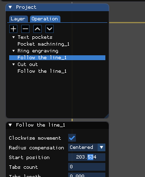

**4. The cut-out with tabs.** The operation *Cut out* (tool T3, 6 mm end mill, depth −6 mm) follows the outer circle, *Outside*, with **three tabs** 12 mm long and 2 mm high. They are spread along the contour, and each one can be moved with the *Tab position* slider.

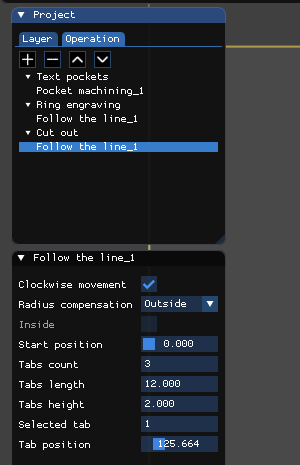

### Example B: a sign

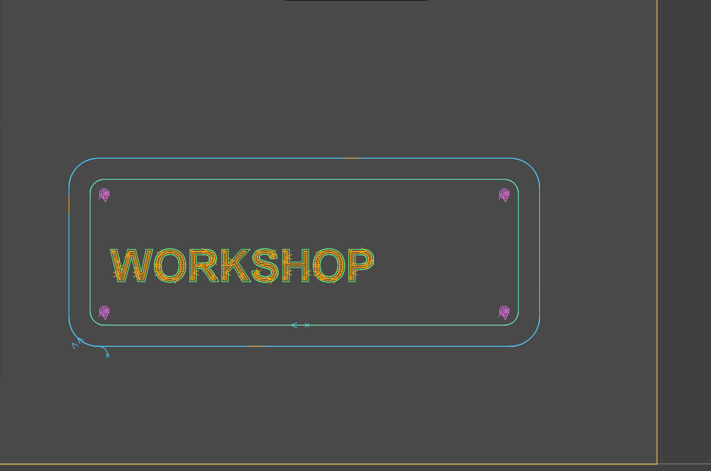

Four layers: **Outline**, **Text** ("WORKSHOP"), **Frame** and **Holes**. Four operations:

| Operation | Tool | Depth | Machining |
|---|---|---|---|
| Text pocket | T2, 3 mm | −2 mm | **zigzag** pocket of the text |
| Frame engraving | T1, 1 mm | −0.5 mm | follow the line, *Centered*, **shifted start** |
| Holes | T2, 3 mm | −4 mm | **spiral** pocket in each hole |
| Cut out | T3, 6 mm | −6 mm | follow the line *Outside*, **4 tabs**, **arc** entry |

**Text pocket.** The text "WORKSHOP" (Arial bold, 55 mm) is cleared in zigzag; with letters of that size, the 3 mm cutter is fine.

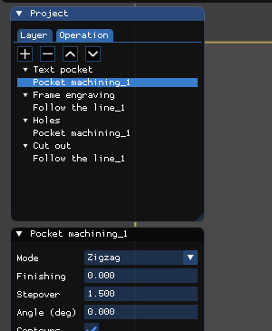

**Engraved frame, shifted start.** The frame is a rectangle with rounded corners made of connected lines and arcs: *follow the line* makes a single path of it. The start position was moved along the frame, away from the corners, so the entry mark of the tool is in the middle of a side.

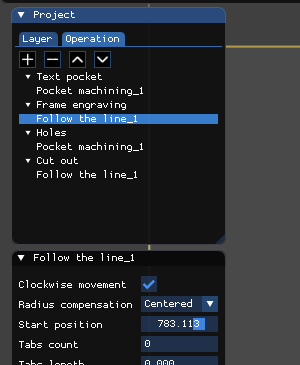

**Holes as spiral pockets.** The four mounting holes are small circles cleared by a **spiral** pocket (*Mode: Spiral*, inward or outward): the 3 mm cutter makes a spiral in an 8 mm hole.

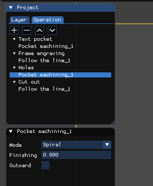

**Cut-out with tabs and arc entry.**

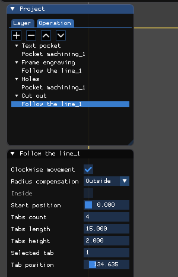

Four tabs 15 mm long hold the plate. The entry of the tool is set in the **operation**:

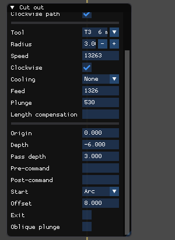

- **Start**: *Normal* (the tool goes down on the first point of the contour), *Line* or *Arc* (the tool reaches the contour along a line or an arc, which avoids marking the edge of the part).
- **Offset**: the size of this entry (8 mm here).
- **Exit**: the same at the end of the contour.
- **Oblique plunge**: the tool goes down at an angle along the entry instead of plunging.

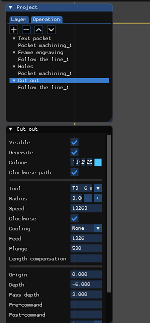

Do not mix up the *Start* of the operation (how the tool reaches the contour) and the *Start position* of a machining (where on the contour it begins).

### Example C: a tray, offset pocket with islands

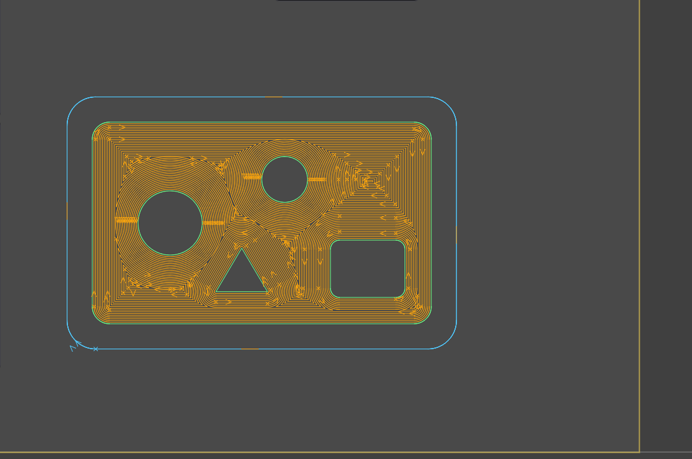

The project `examples/tray.en.opp` is a 340 × 220 mm tray. The layer **Pocket** contains the outline of the pocket (a rectangle with rounded corners) and, **inside it**, four shapes which must stay in place: two circles, a rounded rectangle and a triangle. These shapes are **islands**.

1. Create the operation *Pocket with islands* (tool T2, 3 mm end mill, depth −4 mm, pass depth 2 mm).
2. Select **all** the shapes of the layer **Pocket**: the outline and the islands (**Edit / Select / The layer / Pocket**). Nothing else has to be said: a closed shape **inside** another one is recognised as an island, a shape inside an island becomes material to clear again, and so on.
3. Click the pocket icon and choose the mode **Offset**.

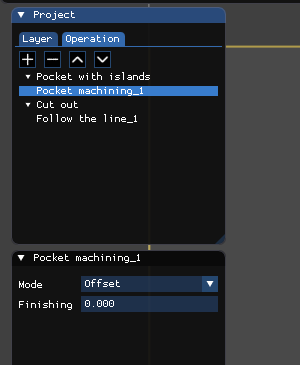

The cutter clears the pocket by **concentric contours**: it follows the outline inward, goes around each island at the distance of the tool radius, and the paths join between the islands. The islands stay untouched, including the corners of the triangle and of the rounded rectangle, which you can check afterwards in the simulator. Compare with the *Zigzag* mode, which hatches the surface with parallel lines: try it on the same project by changing the *Mode* of the machining.

Useful settings: *Finishing* adds a last pass along the walls and the islands; the **radius of the tool** must be smaller than the narrowest width to clear (between two islands, or between an island and the wall), otherwise that space is not machined.

The operation *Cut out* (tool T3, 6 mm end mill, depth −8 mm) follows the outer contour, *Outside*, with four tabs 15 mm long.

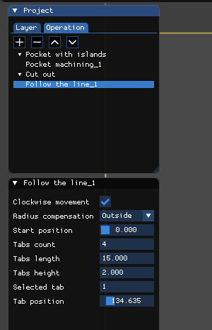

## 12. Going further

- [CAD-SCRIPTS.en.md](CAD-SCRIPTS.en.md): writing a CAD script in Python.
- [POSTPROCESSOR.en.md](POSTPROCESSOR.en.md): writing or adapting a post-processor.
- [SIMULATOR.en.md](SIMULATOR.en.md): the simulator and writing a translator.
- [TOOLS-MACHINES.en.md](TOOLS-MACHINES.en.md): tools, torches, machines and the cutting table.

Always read the output file and run the simulation before you start the machine. The generic post-processors are starting points, not guaranteed profiles for every controller, and the machining algorithms can fail on difficult shapes.
