# Manuel d'utilisation d'OpenPostPro

*English version: [MANUAL.en.md](MANUAL.en.md).*

OpenPostPro est un logiciel de CAO/FAO : on y dessine une pièce (ou on importe un dessin), on prépare les opérations d'usinage, on génère le programme de la machine avec un post-processeur, puis on le vérifie en 3D avant de l'envoyer. Ce manuel suit ce chemin, avec un projet d'exemple du début à la fin. Les références détaillées pour programmer en Python sont les guides listés au chapitre 12.

Les captures viennent de la version 0.6, avec le projet d'exemple `examples/plaque.fr.opp` (ouvrez-le avec **Fichier / Ouvrir** pour suivre en même temps).

## Sommaire

1. [Le chemin du dessin à la machine](#1-le-chemin-du-dessin-à-la-machine)
2. [Premier démarrage et organisation de l'interface](#2-premier-démarrage-et-organisation-de-linterface)
3. [Les menus](#3-les-menus)
4. [Dessiner](#4-dessiner)
5. [Machines et outils](#5-machines-et-outils)
6. [Les opérations](#6-les-opérations)
7. [Les types d'usinage](#7-les-types-dusinage)
8. [Le post-processeur](#8-le-post-processeur)
9. [Les scripts](#9-les-scripts)
10. [Le simulateur](#10-le-simulateur)
11. [Exemples pas à pas](#11-exemples-pas-à-pas)
12. [Pour aller plus loin](#12-pour-aller-plus-loin)

## 1. Le chemin du dessin à la machine

1. **Dessiner** : tracer les formes, ou importer un fichier DXF, SVG, Gerber ou Excellon, ou lancer un script CAO.
2. **Préparer la machine et les outils** : choisir la machine (table, zéro, sens des axes) et les outils (diamètre, avances).
3. **Créer les opérations** : une opération est un outil avec sa profondeur, sa hauteur de passe et ses avances ; on lui ajoute des usinages (suivre un trait, poche, perçage...).
4. **Générer** le fichier de sortie avec le post-processeur de votre commande numérique.
5. **Simuler** le fichier sur un bloc de matière en 3D, et corriger ce que l'on voit.
6. **Envoyer** le fichier à la machine.

Le schéma montre qui fait quoi : les boîtes vertes sont du Python que vous pouvez écrire, les violettes du Python fourni (les moteurs), les grises le programme lui-même.

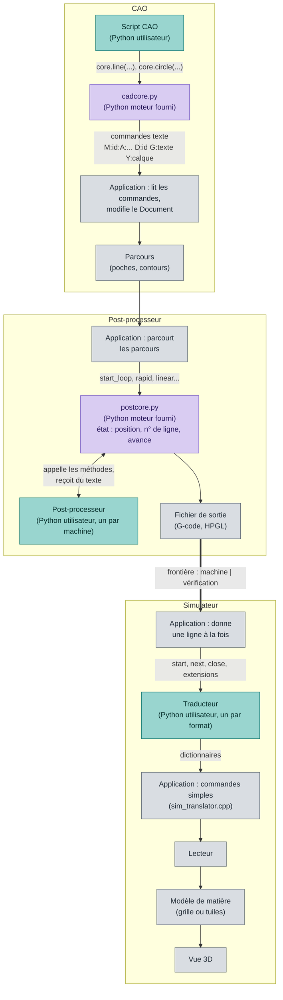

Le fichier de sortie est la frontière entre la machine (le post-processeur) et la vérification (le simulateur).

### Le projet d'exemple

Tout le manuel utilise une plaque de 400 × 200 mm, usinée avec une fraiseuse de 600 × 400 mm : un contour à coins arrondis, quatre trous de fixation, une rosace (deux anneaux gravés, une étoile à 12 branches creusée en poche) et deux rainures. Les formes sont rangées en cinq **calques** (Contour, Trous, Anneaux, Étoile, Rainures) et usinées par cinq **opérations** :

| Opération | Outil | Profondeur | Usinage |
|---|---|---|---|
| Poche étoile | T2, fraise de 3 mm | −3 mm | poche en décalages |
| Gravure anneaux | T1, fraise de 1 mm | −0,5 mm | suivre le trait, centré |
| Rainures | T2, fraise de 3 mm | −3 mm | poche en zigzag |
| Perçage | T2, fraise de 3 mm | −4 mm | quatre perçages |
| Découpe | T3, fraise de 6 mm | −8 mm | suivre le trait à l'extérieur, quatre attaches |

## 2. Premier démarrage et organisation de l'interface

Au tout premier démarrage, une fenêtre **Bienvenue** demande la **langue** de l'interface et l'**unité** par défaut des nouveaux documents (millimètre ou pouce). L'interface change de langue dès que l'on choisit, le bouton **Ok** valide. Les deux choix se modifient plus tard dans **Outils / Préférences**.

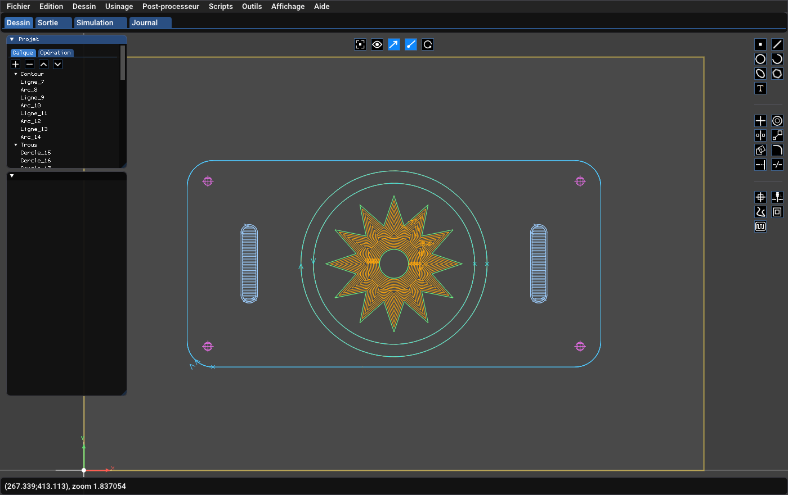

L'écran est composé de :

- **La barre de menus** en haut (chapitre 3).
- **Les onglets de module**, sous la barre de menus : **Dessin** (la CAO et la FAO), **Sortie** (le texte du programme généré), **Simulation** (la simulation 3D) et **Journal** (messages et erreurs). Le journal peut aussi être affiché en bas de l'écran (**Affichage / Journal**).
- **La fenêtre Projet**, en haut à gauche, avec deux onglets : **Calque** (les calques et leurs formes) et **Opération** (les opérations et leurs usinages).
- **La fenêtre des propriétés**, juste dessous : elle montre les réglages de ce qui est sélectionné dans le projet ou dans le dessin. Son titre est le nom de l'élément.
- **La zone de dessin**, au centre. Bouton gauche : sélectionner et dessiner ; bouton droit : déplacer la vue ; molette : zoom. Le rectangle jaune est la table de la machine choisie, le repère en bas à gauche est le zéro de la machine.
- **Les barres d'icônes** : en haut au centre (affichage) et à droite (dessin, modification, usinage), voir ci-dessous.
- **La barre d'état**, en bas : position de la souris dans le dessin (dans l'unité du document) et niveau de zoom.

### La fenêtre Projet

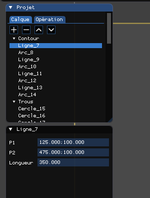

L'onglet **Calque** liste les calques (le triangle replie ou déplie) et leurs formes. Un clic sélectionne une forme et ses propriétés apparaissent en dessous ; **Ctrl-clic** ajoute une forme à la sélection et **Maj-clic** en retire une. Les quatre boutons au-dessus de la liste sont **+** (ajouter), **−** (supprimer), **▲** et **▼** (monter et descendre dans la liste). Un calque a un nom, une couleur, un état visible ou non, et un état verrouillé : les formes d'un calque verrouillé ne peuvent plus être déplacées, modifiées, supprimées, coupées ni prolongées, mais l'aimant s'accroche encore à elles.

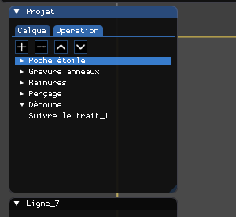

L'onglet **Opération** liste les opérations et, en dessous de chacune, ses usinages (poche, suivre le trait, perçage...). Les boutons **+**, **−**, **▲** et **▼** ajoutent, suppriment et réordonnent les opérations ; **l'ordre des opérations est l'ordre du programme**.

### Les barres d'icônes

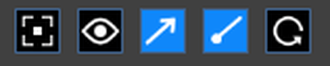

La barre du haut agit sur l'affichage : **cadrer le dessin** dans la fenêtre (touche Début), **afficher ou cacher tous les usinages**, afficher le **sens** des usinages, afficher leur **départ**, et **mettre à jour** les textes liés à une courbe puis les usinages d'après leurs formes (utile après une modification du dessin).

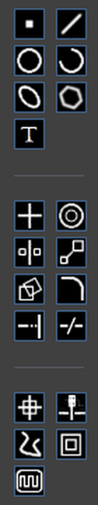

La colonne de droite regroupe trois séries d'icônes, séparées par un trait :

1. **Créer** : point, ligne, cercle, arc, ellipse, polyligne, texte.
2. **Modifier** : déplacer l'origine, décaler, symétrie, échelle, rotation, congé / chanfrein, prolonger, couper.
3. **Usiner** : déplacer à la position, perçage, suivre le trait, contourner le trait, usinage de poche.

Une icône grisée n'est pas disponible : par exemple, l'opération courante utilise une torche, qui ne perce pas et ne creuse pas de poche. Laissez la souris sur une icône un instant pour afficher son nom.

## 3. Les menus

### Fichier

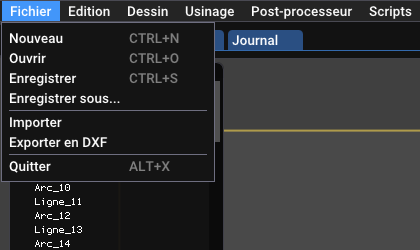

**Nouveau**, **Ouvrir** et **Enregistrer** (documents `.opp`) ; **Importer** ouvre un fichier DXF ; **Exporter en DXF** écrit les formes (seulement la sélection, s'il y en a une). L'import et l'export SVG, Gerber et Excellon sont des scripts (chapitre 9).

### Édition

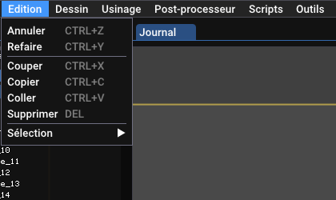

**Annuler / Refaire** (Ctrl+Z, Ctrl+Y), **Couper / Copier / Coller / Supprimer**. Le sous-menu **Sélection** contient : *Tout* (Ctrl+A), *Les objets du calque courant*, *Le calque* (choisit un calque par son nom), *Contour* (sélectionne toutes les formes reliées à la sélection) et *Inverser la sélection*. Ces menus évitent de dessiner un rectangle de sélection au milieu d'un dessin chargé.

### Dessin

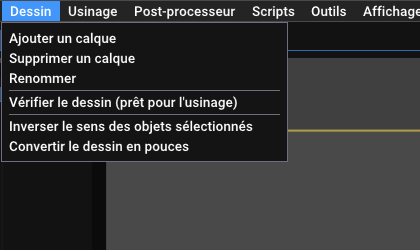

Ajouter, supprimer et renommer un calque ; **Vérifier le dessin** (voir le chapitre 4) ; inverser le sens des objets sélectionnés ; convertir tout le dessin en pouces (ou en millimètres). Avec une sélection, le menu propose aussi de couper aux intersections, les opérations booléennes (fusion, intersection, soustraction), la conversion en spline, et le lien d'un texte à une courbe.

### Usinage

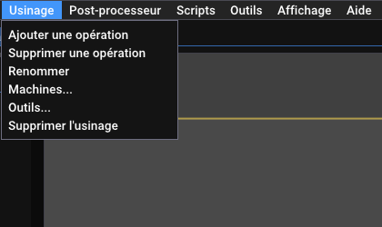

Ajouter, supprimer et renommer une **opération** ; ouvrir la table des **machines** et la table des **outils** (chapitre 5) ; supprimer l'usinage sélectionné.

### Post-processeur

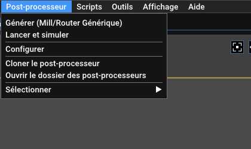

**Générer** écrit le fichier de sortie avec le post-processeur choisi (son nom est entre parenthèses) ; **Lancer et simuler** le génère et le joue dans le simulateur ; **Configurer** ouvre ses réglages ; **Cloner** en fait une copie modifiable ; **Ouvrir le dossier** ; **Sélectionner** choisit le post-processeur par catégorie. Voir le chapitre 8.

### Scripts

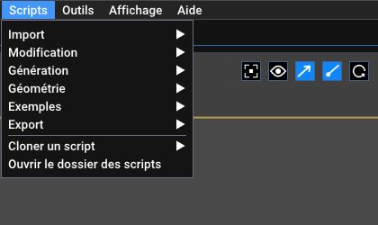

Les scripts livrés sont rangés par catégorie : *Import*, *Modification*, *Génération*, *Géométrie*, *Exemples*, *Export*. **Cloner un script** en fait une copie modifiable. Voir le chapitre 9.

### Outils, Affichage, Aide

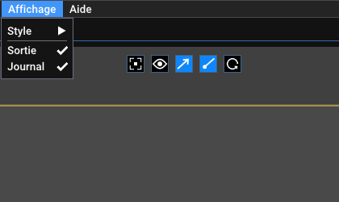

**Outils / Préférences** ouvre les préférences (langue, unité, aspect). **Affichage** choisit le style de l'interface (classique, sombre, clair) et montre ou cache les fenêtres Sortie et Journal. **Aide / À propos** donne la version et la date de compilation.

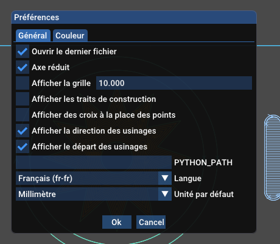

Dans les préférences : ouvrir le dernier fichier au démarrage, axe réduit, grille, traits de construction, croix à la place des points, affichage du sens et du départ des usinages, dossier de Python (`PYTHON_PATH`, si Python n'est pas dans le PATH), langue et unité par défaut ; l'onglet **Couleur** règle les couleurs du dessin, des usinages et de la simulation.

## 4. Dessiner

### Choisir et saisir

Cliquez une icône de la colonne de droite, puis cliquez dans le dessin. La barre d'état donne la position de la souris. Un **aimant** accroche la souris aux points remarquables du dessin (extrémités, centres, intersections) : un petit carré indique le point visé. Les valeurs numériques se tapent dans la fenêtre des propriétés, qui montre la forme dès qu'elle existe. **Échap** annule la création en cours.

### Les formes

| Icône | Forme | Comment la créer |
|---|---|---|
| ▪ | **Point** | un clic |
| ╱ | **Ligne** | deux clics : début et fin |
| ◯ | **Cercle** | le centre, puis un point du cercle |
| ◜ | **Arc** | *par le centre* ou *par trois points* (choix dans la fenêtre qui s'ouvre) |
| ⬭ | **Ellipse** | quelques clics, puis les valeurs dans les propriétés (centre, axes majeur et mineur, angles) |
| ⬡ | **Polyligne** | une suite de clics ; **barre d'espace** ou le bouton *Ajouter* valide |
| T | **Texte** | un clic, puis le texte et la police dans les propriétés |

Un texte a une police, une hauteur, gras et italique, une position par rapport à la ligne (au-dessus, aligné, en dessous), un espacement entre les lettres et un miroir. Il peut **suivre une courbe** (ligne, arc, cercle ou suite de formes reliées) : sélectionnez le texte puis **Dessin / Lier le texte à l'objet** et cliquez la courbe ; le début du texte se règle avec un curseur.

### Les propriétés d'une forme

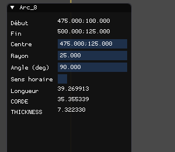

Chaque forme montre ses grandeurs en champs numériques que l'on peut modifier : une **ligne** a ses deux points P1, P2 et sa longueur ; un **cercle** son centre, son rayon et son diamètre ; un **arc** son début, sa fin, son centre, son rayon, son angle, son sens, sa longueur et sa corde. Les points s'écrivent `x;y`. Quand on change le rayon d'un cercle, ou le diamètre, l'autre valeur suit.

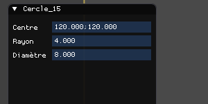

Une sélection de plusieurs formes montre les propriétés de chacune, l'une sous l'autre.

### Modifier

Les icônes de la deuxième série agissent sur la sélection :

- **Déplacer l'origine** : choisit le point qui devient le zéro du dessin.
- **Décaler** : copie la sélection à une distance donnée (de chaque côté).
- **Symétrie** : miroir par rapport à un axe que l'on désigne.
- **Échelle** : agrandit ou réduit d'un facteur.
- **Rotation** : tourne de l'angle saisi autour d'un point.
- **Congé / chanfrein** : arrondit ou coupe un angle entre deux lignes (le rayon se règle dans la fenêtre qui s'ouvre).
- **Prolonger** : allonge une ligne ou un arc, depuis l'extrémité la plus proche de la souris, jusqu'à la forme la plus proche ; le résultat s'affiche sous la souris avant le clic.
- **Couper** : coupe une ligne, un arc, un cercle, une polyligne ou une ellipse au point cliqué (l'aimant reste actif) ou à l'intersection des formes sous le clic.

### Vérifier le dessin

**Dessin / Vérifier le dessin** cherche les problèmes qui gênent l'usinage et les marque sur le dessin : formes de **longueur nulle**, formes **en double** et **extrémités libres** (contour ouvert). Un usinage « suivre le trait » ou « poche » attend des contours fermés. Le message du journal dit « le dessin est prêt pour l'usinage » quand rien n'est trouvé ; *Effacer les marqueurs* les retire.

### Import et export

**Fichier / Importer** lit un DXF : lignes, points, cercles, arcs, ellipses, polylignes, splines (B-splines et NURBS), textes et blocs (avec position, échelle et rotation). Les extrémités éloignées de moins de 0,01 sont reliées. **Fichier / Exporter en DXF** écrit un DXF AutoCAD R12. Les scripts du menu **Scripts / Import** et **Export** lisent et écrivent SVG, Gerber (RS-274X) et Excellon.

## 5. Machines et outils

### Les machines

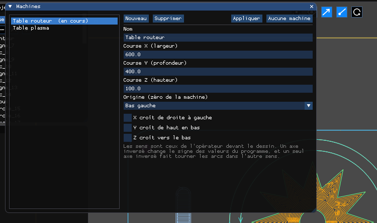

**Usinage / Machines...** ouvre la table des machines : la liste à gauche, les réglages de la machine choisie à droite. Une machine donne :

- la **course** en X, Y et Z : la surface de la table s'affiche sous le dessin (rectangle jaune), et un usinage qui en sort est signalé par « Hors de la zone de la machine » ;
- l'**origine** (le zéro de la machine) : en bas à gauche, en bas à droite, en haut à gauche, en haut à droite ou au centre ;
- le **sens des axes** : « X croît de droite à gauche », « Y croît de haut en bas », « Z croît vers le bas ». Les sens sont ceux de l'opérateur devant le dessin. Un axe inversé change le signe des valeurs du programme ; un seul axe inversé fait tourner les arcs dans l'autre sens, et le post-processeur et le simulateur en tiennent compte.

**Appliquer** utilise la machine pour le document ; **Aucune machine** retire la machine du document. La machine est enregistrée dans le document.

### Les outils

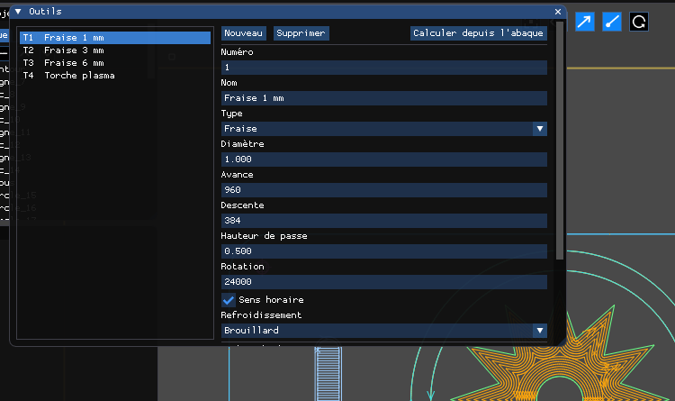

**Usinage / Outils...** ouvre la table des outils : la liste (T1, T2...) et les réglages de l'outil choisi :

| Champ | Rôle |
|---|---|
| Numéro | le numéro `Tn` du programme ; unique |
| Nom | texte libre |
| Type | fraise, torche plasma, jet d'eau, électro-érosion |
| Diamètre | diamètre de la fraise, ou **largeur de coupe** d'une torche |
| Avance, Descente | avance de coupe et avance de plongée (mm/min) |
| Hauteur de passe | profondeur retirée à chaque passe |
| Rotation, Sens horaire, Refroidissement | broche et arrosage (fraise seulement) |
| Nombre de dents, Matériau usiné | pour **Calculer depuis l'abaque** : le logiciel propose rotation et avance d'après le diamètre, le nombre de dents et le matériau (valeurs indicatives pour fraises carbure, à ajuster) |

Les changements sont enregistrés tout de suite. Les détails (torches, descente oblique, abaque) sont dans [TOOLS-MACHINES.fr.md](TOOLS-MACHINES.fr.md).

## 6. Les opérations

Une **opération** rassemble les réglages d'un outil et les usinages qui l'utilisent. Créez-en une avec **Usinage / Ajouter une opération**, puis choisissez-la dans l'onglet **Opération** : ses propriétés s'affichent.

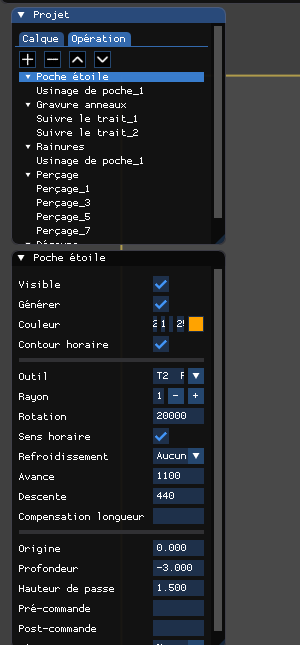

| Réglage | Effet |
|---|---|
| Visible | montre ou cache les usinages de l'opération dans le dessin |
| Générer | si coché, l'opération est écrite dans le programme ; décochée, elle est sautée |
| Couleur | couleur des usinages dans le dessin |
| Contour horaire | sens de parcours des contours fermés (horaire ou anti-horaire) |
| Outil | l'outil de la table ; ses réglages sont copiés dans l'opération, que l'on peut ensuite modifier |
| Rayon | rayon de l'outil (sert aux décalages, aux poches et à la compensation) |
| Rotation, Sens horaire | vitesse et sens de la broche |
| Refroidissement | aucun, arrosage ou brouillard |
| Avance, Descente | avance de coupe, avance de plongée |
| Compensation longueur | numéro de correcteur de longueur (laisser vide sinon) |
| Origine | hauteur Z de la surface de la matière |
| Profondeur | profondeur finale (négative, sous l'origine) |
| Hauteur de passe | profondeur retirée à chaque passe : la profondeur est atteinte en plusieurs passes |
| Pré-commande, Post-commande | texte libre écrit avant et après l'opération (par exemple un M8 / M9) |
| Départ | où commencent les parcours fermés : normal, ou décalé |

Les usinages d'une opération sont faits dans l'ordre de la liste. **Usinage / Supprimer l'usinage** retire celui qui est sélectionné.

### Créer un usinage

1. Choisissez l'opération dans l'onglet **Opération**.
2. Sélectionnez les formes (un clic, un rectangle, ou **Édition / Sélection / Le calque**).
3. Cliquez l'icône de l'usinage dans la colonne de droite.

L'usinage apparaît sous l'opération, avec son propre jeu de propriétés. Les formes du dessin peuvent être modifiées ensuite : le bouton *mettre à jour les usinages* de la barre du haut les recalcule.

## 7. Les types d'usinage

### Suivre le trait

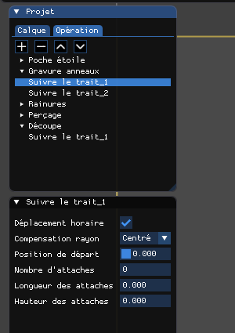

Fait suivre à l'outil les formes sélectionnées. Une opération « suivre le trait » est créée **par forme ou chaîne de formes reliées** : les deux anneaux de l'exemple donnent deux usinages. Réglages :

- **Déplacement horaire** : sens de parcours.
- **Compensation rayon** : *Centré* (l'axe de l'outil est sur le trait, par exemple pour graver), *Extérieur* ou *Intérieur* (l'outil reste à l'extérieur ou à l'intérieur de la forme : c'est la coupe d'un contour). Le côté est déduit du sens de parcours. Le post-processeur écrit G41 / G42, et pour une torche la largeur de coupe est compensée de la même façon.
- **Position de départ** : où le parcours commence sur la forme.
- **Entrée et sortie** : une ligne ou un quart de cercle, pour entrer et sortir de la matière sans marquer la pièce.

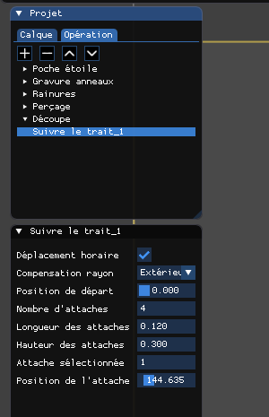

Sur un contour fermé, les **attaches** (ponts) retiennent la pièce pour qu'elle ne bouge pas à la fin de la découpe : *Nombre d'attaches*, *Longueur*, *Hauteur*, puis *Attache sélectionnée* et sa *position*, que l'on déplace avec un curseur. L'outil remonte à la hauteur de l'attache et la redescend ensuite. Dans le programme, la découpe de la plaque se lit :

```
(TOOLPATH [Suivre le trait_1])
G41
F530
G1Z-8
F1326
G2X100Y125J25
G1Y230.305054
Z-7.7
Y230.425049
Z-8
```

`G41` est la compensation de rayon, `Z-7.7` le passage sur une attache (hauteur 0,3 mm).

### Poche

Vide l'intérieur d'une forme fermée, **îlots** respectés (le disque central de l'étoile reste en place). Trois stratégies, au choix dans *Mode* :

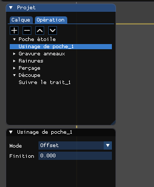

| Mode | Principe |
|---|---|
| **Zigzag** | lignes parallèles dans la forme, à un angle quelconque ; réglages : *Pas* (écart entre deux lignes), *Angle*, et *Contours* (avec ou sans repasser sur le contour) |
| **Décalage** (offset) | contours concentriques qui rétrécissent vers le centre |
| **Spirale** | une spirale vers l'intérieur ou vers l'extérieur |

*Finition* ajoute une dernière passe de finition le long du contour, usinée en dernier. Un usinage de poche utilise les réglages de l'opération (rayon, profondeur, hauteur de passe) : une poche de 3 mm de profondeur avec 1,5 mm de hauteur de passe est faite en deux passes. L'icône est grisée avec une torche.

### Perçage

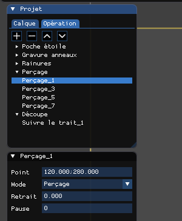

Cliquez l'icône de **perçage**, puis cliquez les points à percer dans le dessin (l'aimant vise les centres des cercles) ; chaque clic crée un perçage. Réglages : le **point**, le **mode** (*Manuel*, *Perçage*, *Débourrage*, *Taraudage*, *Alésage*), le **retrait** (hauteur de remontée) et la **pause**. Les modes utilisent des cycles fixes du programme :

```
(TOOLPATH [Perçage_1])
G0Y280
G81G99Z-4R0
```

Appuyez sur **Échap** après le dernier point pour quitter la création de perçages.

### Déplacer à

Ajoute à l'opération un déplacement de positionnement vers un point que l'on clique.

### Contourner le trait et spirale

*Contourner le trait* crée des décalages intérieurs ou extérieurs de la forme choisie ; *spirale* crée des parcours en spirale. Ces deux usinages ne sont pas illustrés ici : essayez-les sur le projet d'exemple et regardez leurs propriétés.

## 8. Le post-processeur

Le **post-processeur** transforme les usinages en programme pour votre commande numérique. Il est écrit en Python et se modifie sans toucher au logiciel (voir [POSTPROCESSOR.fr.md](POSTPROCESSOR.fr.md)).

### Choisir

**Post-processeur / Sélectionner** liste les post-processeurs par catégorie : *Mill / Router* (fraisage générique), *Plasma* (découpe plasma générique) et des variantes de commandes : **Mach3** (fichier `.tap`, centres d'arc absolus avec `G90.1`), **Num 1060** (espaces entre les mots, pas de `G64`, temporisation avec `F`), **Burny 2.5** (chaque arc donne `X Y I J`) pour le fraisage et pour le plasma, et **HPGL** pour les traceurs et les découpeuses de vinyle (le numéro d'outil est le stylo). Ce sont des points de départ : relisez la sortie et adaptez-la à votre machine avant usage.

### Configurer

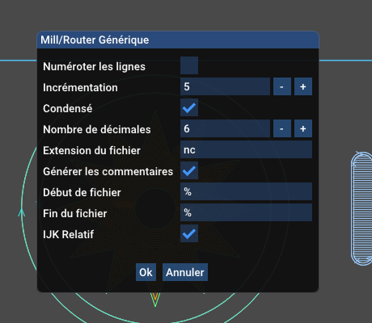

**Post-processeur / Configurer** ouvre les réglages du post-processeur choisi. Pour le fraisage générique :

| Réglage | Effet sur le fichier |
|---|---|
| Numéroter les lignes | ajoute un numéro `N` au début de chaque ligne |
| Incrémentation | pas entre deux numéros (`N5`, `N10`, ...) |
| Condensé | sans espace entre les mots : `G1X10Y5` au lieu de `G1 X10 Y5` |
| Nombre de décimales | maximum de décimales des nombres écrits |
| Extension du fichier | extension du fichier de sortie (`nc`, `tap`...) |
| Générer les commentaires | écrit les lignes `(OPERATION [...])` et `(TOOLPATH [...])` |
| Début de fichier, Fin du fichier | caractères écrits en tête et en fin de fichier (souvent `%`) |
| IJK relatif | le centre des arcs est donné relativement au départ (coché), ou en absolu |

Les post-processeurs de plasma ajoutent des réglages de torche (commandes d'allumage, temps de perçage, référence, gestion de l'axe Z). Les réglages sont conservés d'une session à l'autre.

### Générer

**Post-processeur / Générer** écrit le fichier à l'emplacement de sortie du document (son nom et son extension viennent du réglage *Extension du fichier*), et l'onglet **Sortie** en montre le texte :

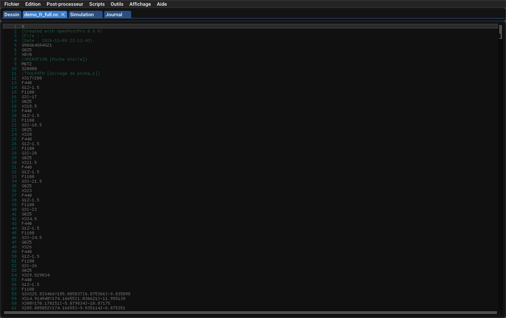

Le programme de l'exemple commence ainsi :

```
%
(Created with OpenPostPro 0.6.0)
G90G64G94G21
G0Z5
X0Y0
(OPERATION [Poche étoile])
M6T2
S20000
(TOOLPATH [Usinage de poche_1])
X317Y200
F440
G1Z-1.5
F1100
G3I-17
```

On y lit les trois niveaux : l'opération (`M6T2` : l'outil 2 ; `S20000` : la broche), l'usinage (le commentaire), puis les déplacements. Les opérations sont écrites dans l'ordre de la liste de l'onglet **Opération**, et l'outil est changé à chaque opération.

Le menu **Post-processeur / Cloner** copie un post-processeur livré (en lecture seule) sous un nouveau nom pour l'adapter à votre commande, avec l'éditeur intégré (**Compiler** vérifie la syntaxe).

## 9. Les scripts

Un **script** est un petit programme Python qui crée ou modifie des formes dans le dessin : un rectangle, un engrenage, un réseau, un congé, une vectorisation d'image... Les scripts livrés sont dans le menu **Scripts** :

- **Génération** : rectangle, hexagone, étoile, trou oblong, rayons de roue, roue dentée à denture droite extérieure, profil d'aile depuis un fichier de coordonnées, grille de trous.
- **Modification** : réseau linéaire et polaire de la sélection, chanfrein, congé.
- **Géométrie** : centre de gravité, échelle des cercles.
- **Import / Export** : SVG, Gerber et Excellon (pastilles, pistes, régions, trous), vectorisation d'image avec Potrace.
- **Exemples** : petits scripts pour apprendre (milieu des lignes, rectangle...).

Lancer un script : choisissez-le dans le menu ; une fenêtre demande ses paramètres (par exemple la largeur et la hauteur d'un rectangle), **Ok** le lance. Le script reçoit la sélection, la position de la souris et l'unité du document ; la forme est créée à la position de la souris. **Chaque exécution s'annule en une seule étape** (Ctrl+Z).

Les scripts livrés sont en lecture seule : **Scripts / Cloner un script** en fait une copie modifiable, avec l'éditeur intégré (**Enregistrer**, **Compiler**). Une erreur Python s'écrit dans le journal avec la trace et la ligne. Pour écrire un script, voir [CAD-SCRIPTS.fr.md](CAD-SCRIPTS.fr.md).

## 10. Le simulateur

Le **simulateur** joue le programme sur un bloc de matière en 3D, avant de l'envoyer à la machine. **Post-processeur / Lancer et simuler** génère le programme du document et l'ouvre dans l'onglet **Simulation** ; **Programme actuel** recharge la sortie du document, **Ouvrir...** charge un fichier de G-code quelconque (qu'on peut aussi déposer sur la fenêtre).

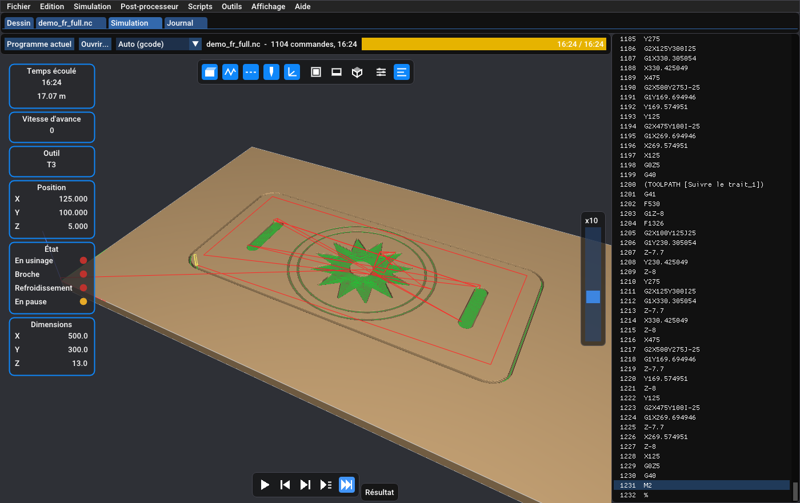

L'écran se lit ainsi :

- **La vue 3D**, au centre : le bloc de matière, les déplacements d'avance (verts) et rapides (rouges), l'outil. Bouton gauche : tourner ; bouton droit : déplacer ; molette : zoom.
- **Les cartes**, à gauche : temps écoulé et longueur parcourue, vitesse d'avance, outil, position X Y Z, état (usinage, broche, arrosage, pause) et dimensions de la zone usinée.
- **Le programme**, à droite : la ligne jouée est en couleur (rouge pour une erreur, jaune pour un avertissement) ; un clic sur une ligne va à cette ligne.
- **Les boutons de lecture**, en bas : lecture / pause (barre d'espace), retour au début, **pas** (jusqu'à la fin du prochain mouvement), **ligne** (jusqu'à la fin de la ligne suivante) et **résultat** (va à la fin du programme). Le curseur de droite règle la vitesse, de ×1 (la vitesse réelle de la machine) à ×500, ou pleine vitesse.
- **La barre en haut** : le traducteur (*Auto*, ou un traducteur forcé), le nom du programme, le nombre de commandes, et le temps total.

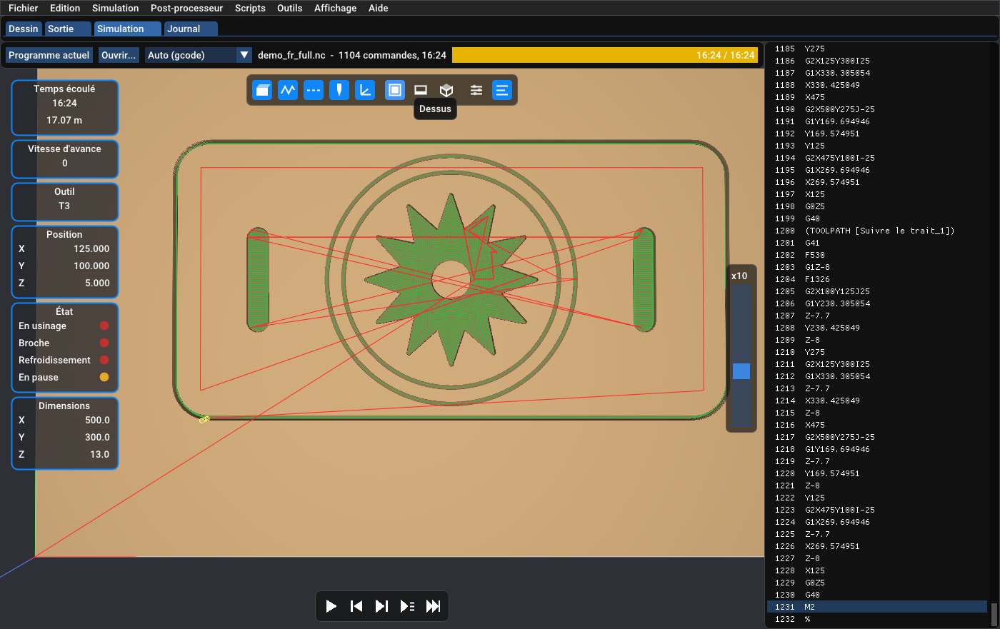

Les icônes de la barre du dessus montrent ou cachent la **matière**, les déplacements d'**usinage** et **rapides**, l'**outil** et les **axes**, et choisissent la vue **dessus**, **face** ou **iso**.

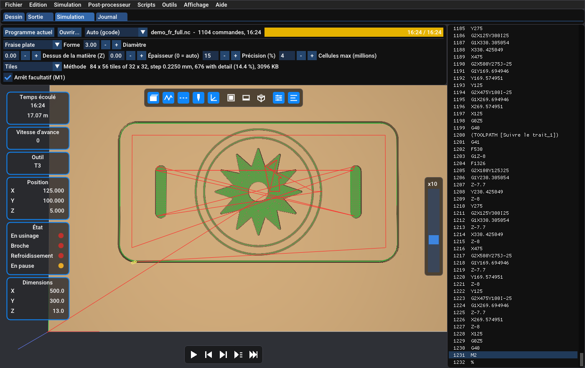

Le dernier groupe d'icônes ouvre les **réglages** : la forme de l'outil (fraise plate, hémisphérique, torique, conique, torche plasma), son diamètre, le rayon du coin d'une fraise torique ou l'angle d'une fraise conique, le dessus de la matière (Z), l'épaisseur (0 = automatique), la précision en pourcentage du rayon de l'outil, et l'arrêt facultatif `M1`. Changer un réglage refait le bloc et rejoue le programme.

Ce que le simulateur vérifie et ne vérifie pas : il joue le chemin programmé (le chemin tel que la commande le fera), il détecte les erreurs et avertissements du programme et calcule la durée d'usinage d'après les avances. Ce n'est pas un modèle complet de la machine : la compensation de rayon (G41 / G42) n'est pas appliquée, et les axes A, B, C sont ignorés. Le traducteur (Python) qui lit le programme est choisi d'après l'extension du fichier, ou forcé dans la liste ; voir [SIMULATOR.fr.md](SIMULATOR.fr.md) pour écrire le vôtre.

## 11. Exemples pas à pas

Trois projets d'exemple complètent la plaque : `examples/medaillon.fr.opp`, `examples/enseigne.fr.opp` et `examples/bac.fr.opp` (ouvrez-les avec **Fichier / Ouvrir**). Ils servent à voir ensemble **les poches de texte**, **le texte autour d'un cercle**, **les attaches**, **les départs décalés** et **les poches avec îlots**. Ils utilisent la même table routeur et les mêmes outils que la plaque.

### Exemple A : un médaillon, texte autour d'un cercle

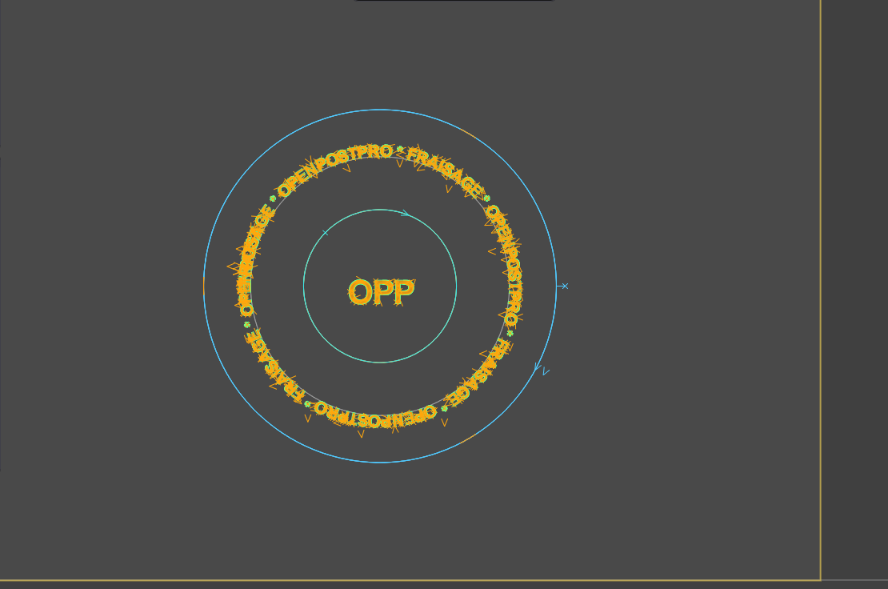

Le dessin tient en quatre calques : **Bord** (le cercle extérieur, qui sera découpé), **Guide** (le cercle gris, de rayon 88 mm, sur lequel le texte s'enroule), **Anneau** (le cercle gravé au centre) et **Texte** (le texte circulaire et le texte central « OPP »).

**1. Le texte autour du cercle.**

1. Créez le cercle guide, puis un texte avec l'outil **T** (police Arial, gras, hauteur 16 mm).
2. Sélectionnez le texte, choisissez **Dessin / Lier le texte à l'objet** (ou le bouton de ses propriétés) et cliquez le cercle guide. Le texte épouse la courbe ; ses lettres gardent leur taille.
3. Dans les propriétés du texte, **Position** choisit le côté : *Au-dessus* place les lettres à l'extérieur du cercle, *En dessous* à l'intérieur. **Début** décale le départ du texte le long de la courbe, **Inter-espace** écarte les lettres. Sur une courbe fermée, le texte fait le tour ; sur une courbe ouverte, il continue en ligne droite après le bout.
4. Le texte suit sa courbe quand on la déplace à la souris ou quand on change l'origine ou l'unité ; dans les autres cas, le bouton *mettre à jour* de la barre du haut relit la courbe. Un texte plus court que le cercle laisse un vide : l'exemple répète son motif pour faire le tour complet.

**2. La poche des textes.** Créez l'opération *Poche des textes* (outil T1, fraise de 1 mm, profondeur −0,8 mm). Sélectionnez les deux textes (**Édition / Sélection / Le calque / Texte**), puis l'icône de poche, mode **Zigzag**.

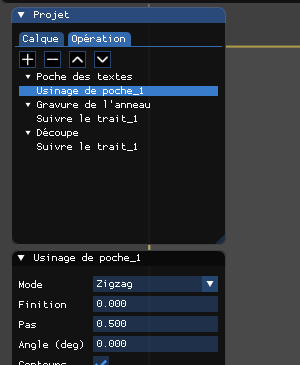

Les lettres sont creusées en gardant leurs contours : l'outil doit être **plus petit que le trait des lettres**, sinon les lettres ne sont pas vidées. Avec une fraise de 1 mm, un texte de 16 mm de haut se vide sans problème.

**3. Un départ décalé.** L'opération *Gravure de l'anneau* suit le cercle central (*suivre le trait*, *Centré*). Un cercle n'a pas de début naturel : le **départ** est l'endroit où l'outil descend. La *Position de départ* le déplace le long du contour avec un curseur ; ici il est décalé, ce qui se voit à la flèche de sens et au repère de départ sur le dessin.

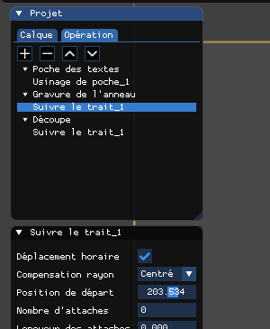

**4. La découpe avec attaches.** L'opération *Découpe* (outil T3, fraise de 6 mm, profondeur −6 mm) suit le cercle extérieur, *Extérieur*, avec **trois attaches** de 12 mm de long et 2 mm de haut. Elles se répartissent sur le contour, et chacune se déplace avec le curseur *Position de l'attache*.

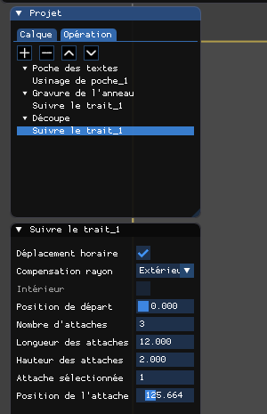

### Exemple B : une enseigne

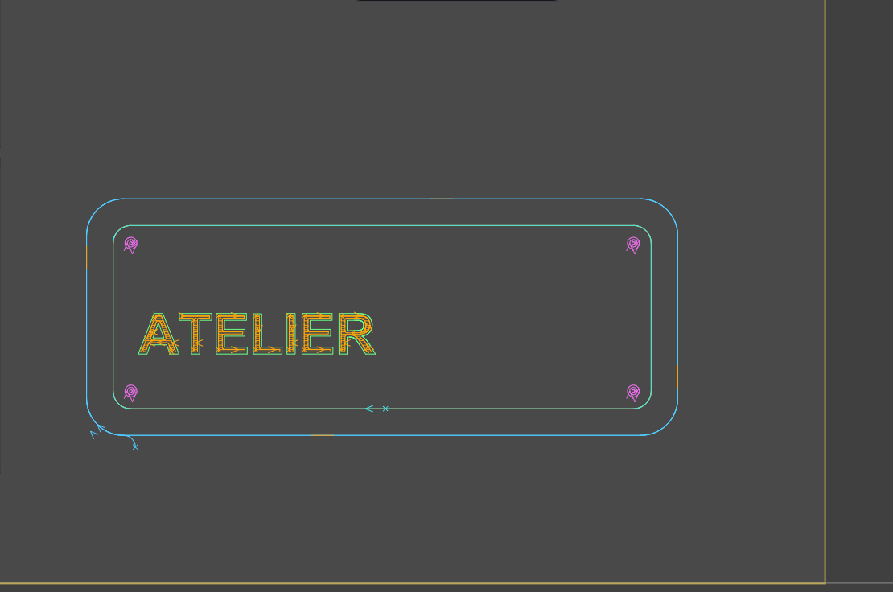

Quatre calques : **Contour**, **Texte** (« ATELIER »), **Cadre** et **Trous**. Quatre opérations :

| Opération | Outil | Profondeur | Usinage |
|---|---|---|---|
| Poche du texte | T2, 3 mm | −2 mm | poche **zigzag** du texte |
| Gravure du cadre | T1, 1 mm | −0,5 mm | suivre le trait, *Centré*, **départ décalé** |
| Perçage | T2, 3 mm | −4 mm | poche en **spirale** dans chaque trou |
| Découpe | T3, 6 mm | −6 mm | suivre le trait *Extérieur*, **4 attaches**, entrée en **arc** |

**Poche de texte.** Le texte « ATELIER » (Arial gras, 55 mm) est vidé en zigzag ; avec des lettres de cette taille, la fraise de 3 mm convient.

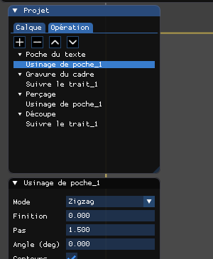

**Cadre gravé, départ décalé.** Le cadre est un rectangle à coins arrondis fait de lignes et d'arcs reliés : *suivre le trait* en fait un seul parcours. La position de départ a été déplacée le long du cadre, loin des coins, pour que la marque d'entrée de l'outil soit au milieu d'un côté.

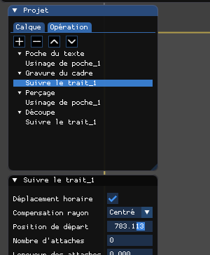

**Trous en poche spirale.** Les quatre trous de fixation sont de petits cercles que l'on vide par une poche en **spirale** (*Mode : Spirale*, vers l'intérieur ou vers l'extérieur) : la fraise de 3 mm décrit une spirale dans un trou de 8 mm.

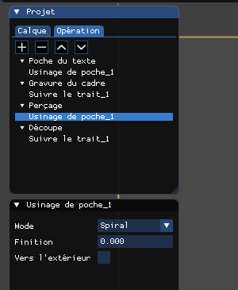

**Découpe avec attaches et entrée en arc.**

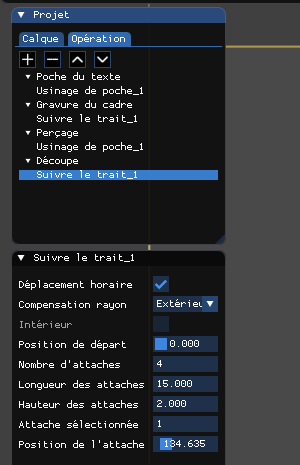

Quatre attaches de 15 mm de long retiennent la plaque. L'entrée de l'outil se règle dans l'**opération** :

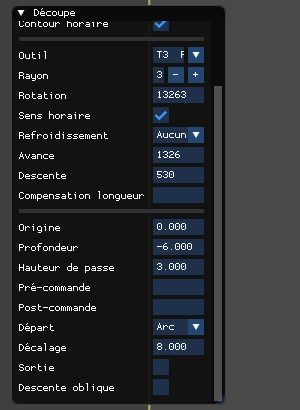

- **Départ** : *Normal* (l'outil descend sur le premier point du contour), *Ligne* ou *Arc* (l'outil arrive sur le contour par une ligne ou par un arc, ce qui évite de marquer le bord de la pièce).
- **Décalage** : la taille de cette entrée (8 mm ici).
- **Sortie** : la même chose à la fin du contour.
- **Descente oblique** : l'outil descend en biais le long de l'entrée au lieu de plonger.

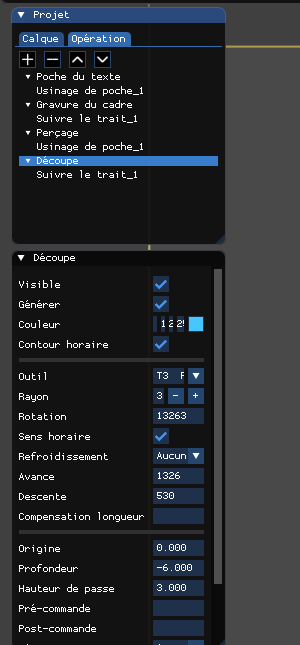

Ne confondez pas le *Départ* de l'opération (comment l'outil arrive sur le contour) et la *Position de départ* d'un usinage (l'endroit du contour où il commence).

### Exemple C : un bac, poche en décalages avec îlots

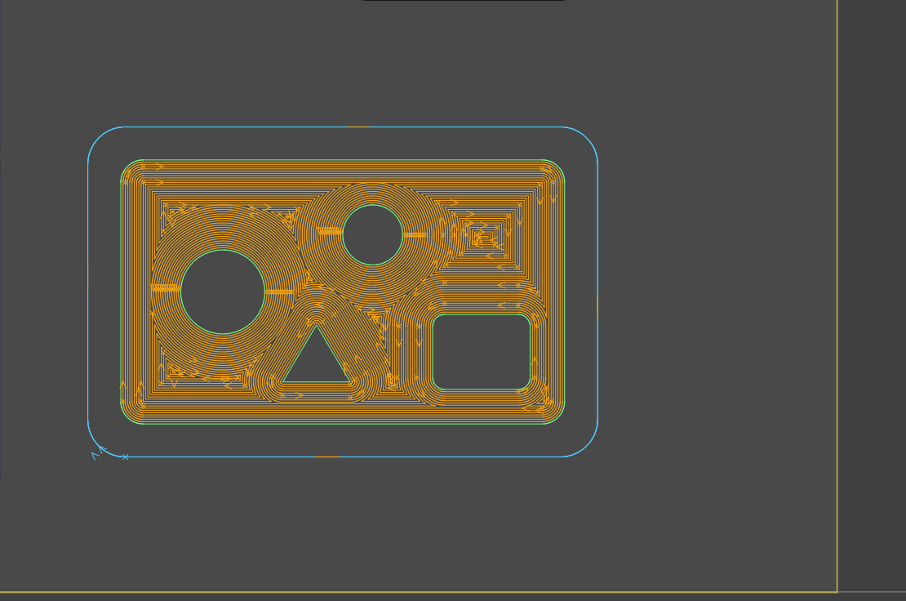

Le projet `examples/bac.fr.opp` est un bac de 340 × 220 mm. Le calque **Poche** contient le contour de la poche (un rectangle à coins arrondis) et, **à l'intérieur**, quatre formes qui doivent rester en place : deux cercles, un rectangle arrondi et un triangle. Ces formes sont des **îlots**.

1. Créez l'opération *Poche à îlots* (outil T2, fraise de 3 mm, profondeur −4 mm, hauteur de passe 2 mm).
2. Sélectionnez **toutes** les formes du calque **Poche** : le contour et les îlots (**Édition / Sélection / Le calque / Poche**). Il n'y a rien d'autre à indiquer : une forme fermée **à l'intérieur** d'une autre est reconnue comme un îlot, une forme à l'intérieur d'un îlot redevient de la matière à vider, et ainsi de suite.
3. Cliquez l'icône de poche et choisissez le mode **Décalage** (*offset*).

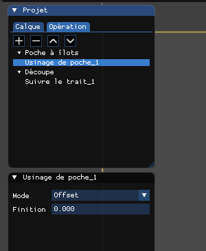

La fraise vide la poche par **contours concentriques** : elle suit le contour vers l'intérieur, contourne chaque îlot à distance du rayon de l'outil, et les parcours se rejoignent entre les îlots. Les îlots restent intacts, y compris les angles du triangle et du rectangle arrondi, que l'on vérifie ensuite dans le simulateur. Comparez avec le mode *Zigzag*, qui hachure la surface par lignes parallèles : essayez-le sur le même projet en changeant le *Mode* de l'usinage.

Réglages utiles : *Finition* ajoute une dernière passe le long des parois et des îlots ; le **rayon de l'outil** doit être plus petit que la plus petite largeur à vider (entre deux îlots, ou entre un îlot et la paroi), sinon l'espace n'est pas usiné.

L'opération *Découpe* (outil T3, fraise de 6 mm, profondeur −8 mm) suit le contour extérieur, *Extérieur*, avec quatre attaches de 15 mm.

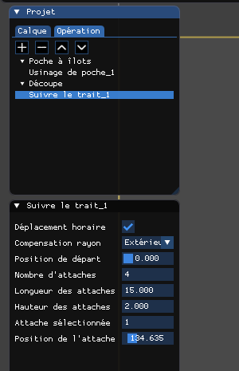

## 12. Pour aller plus loin

- [CAD-SCRIPTS.fr.md](CAD-SCRIPTS.fr.md) : écrire un script CAO en Python.
- [POSTPROCESSOR.fr.md](POSTPROCESSOR.fr.md) : écrire ou adapter un post-processeur.
- [SIMULATOR.fr.md](SIMULATOR.fr.md) : le simulateur et l'écriture d'un traducteur.
- [TOOLS-MACHINES.fr.md](TOOLS-MACHINES.fr.md) : outils, torches, machines et abaque de coupe.

Relisez toujours le fichier de sortie et lancez la simulation avant de lancer la machine. Les post-processeurs génériques sont des points de départ, pas des profils garantis pour toutes les commandes numériques, et les algorithmes d'usinage peuvent échouer sur des formes difficiles.
