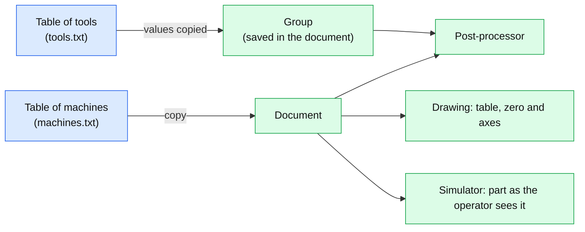

# Tools, torches and machines

*Version française : [TOOLS-MACHINES.fr.md](TOOLS-MACHINES.fr.md).*

This page describes how a **tool** and a **machine** are defined, and what they change in the groups, the post-processor and the simulator. CAD scripts are in [CAD-SCRIPTS.en.md](CAD-SCRIPTS.en.md), post-processors in [POSTPROCESSOR.en.md](POSTPROCESSOR.en.md), the simulator in [SIMULATOR.en.md](SIMULATOR.en.md).

Covered here: the table of tools, the tool of a group, torches (plasma, water jet, wire EDM), the oblique plunge, the table of cutting data, the machines, and the tests.

## 1. The table of tools

**Machining > Tools...** opens the window of the tools: the list on the left (`T1  End mill 6 mm`), the fields of the selected tool on the right, and the buttons **New** and **Remove** (the next tool is selected after a removal, or the previous one if it was the last). Every change is saved at once in `tools.txt` of the data folder of the application (`~/.openpostpro`, or the folder given by the environment variable `OPP_PROFILE`).

| Field | Meaning |
|---|---|
| Number | the number `Tn` of the program; unique. A number already used is refused (a new tool takes the next free one) |
| Name | free text, shown in the lists |
| Type | *End mill*, *Plasma torch*, *Water jet*, *Wire EDM* |
| Diameter | the diameter of the cutter, or the **kerf width** of a torch |
| Feed | the cutting feed, in mm/min |
| Plunge, Pass depth, Rotation, Clockwise, Cooling | for a cutter only |
| Teeth | number of teeth (see section 5) |

The file has one line per tool, `number;name;type;diameter;feed;plunge;pass;spindle;cw;cooling;teeth`. A line which lacks the last fields (a file written by an older version) is read with the default values, and a damaged line is ignored.

## 2. The tool of a group

In the properties of a group, the field **Tool** works as an editable list:

- When the number is the one of a tool of the table, the field shows its **name** (`T2  End mill 6 mm`); the whole text is in the tooltip. Otherwise it shows the number.
- A click on the field lets you type a number (Enter validates, Escape cancels). The arrow at the right opens the list of the tools.
- Choosing a tool **copies its values into the group**: radius (diameter / 2), feed, finishing feed, plunge feed, pass depth, spindle speed and direction, cooling, and its type. They stay editable in the group. Changing the tool in the table later does not change the groups which already used it: the group is self-contained, and a document opened on another computer keeps its values.

The group saves the new values in the document (tool type, pass depth, spindle speed and direction, cooling, oblique plunge). A document written before these fields exist is read with the default values.

## 3. Torches

A tool whose type is not *End mill* is a **torch**. A group which uses it:

- hides what a torch does not have: spindle speed and direction, cooling, plunge, pass depth, oblique plunge;
- is post-processed in **one pass** at the depth of the group (the cutting height), with no steps;
- disables the **Pocket** and **Drilling** buttons of the drawing toolbar while it is the current group.

In the simulator, when the first group of the document uses a torch, the tool is a plasma torch: it cuts **through** the block along its cutting moves (G1, G2, G3), whatever its height (a torch stays above the sheet, at 0.5 mm for instance). When the program lights the torch (M3 or the torch command), it cuts only while it is lit; if the program never lights it, every cutting move cuts.

## 4. Oblique plunge

At the start of a path with an **entry** (a line or an arc, setting *Start* of the group), the tool can go down along the entry instead of plunging vertically. The check box **Oblique plunge** is shown in the group when the start is not *Normal* (and for a cutter only).

- The tool goes to the height of the surface above the start of the entry (rapid), then does the entry going down, with the plunge feed, and arrives at the depth of the pass at the end of the entry. An arc gives a helix.
- The first pass starts from the origin (the surface); the next ones from the depth of the previous pass.
- Without an entry (start *Normal*), or when the tool is already at the depth, the plunge stays vertical.

The sequence of the moves is in `postpro/cut_path.h`, shared with the post-processor, and tested without a window.

## 5. The table of cutting data

In the window of the tools, for a cutter, the fields **Teeth**, **Material** and **Maximum spindle speed**, and the button **Compute from the table** (top right) fill the spindle speed, the feed, the plunge feed, the pass depth and the cooling of the tool.

- Spindle speed: `n = Vc × 1000 / (π × D)`, limited to the maximum of the machine (a message says so; the feed follows the lower speed).
- Feed: `F = n × teeth × fz`, where `fz` (feed per tooth) is interpolated between the columns 3, 6, 12 and 20 mm of the material.
- Plunge feed: a part of the feed (30 to 50 %). Pass depth: a part of the diameter (0.2 × D for stainless steel, up to 1 × D for wood). Cooling: mist for aluminium, flood for steels.

Materials: aluminium, brass and copper, mild steel, stainless steel, hardwood, softwood, MDF and plywood, plastic.

**These are indicative values** for carbide end mills (slot, roughing), in millimeters. They depend on the machine, its rigidity and the tool: adjust them in the table and check the catalogue of the maker of your tools. The table is in `src/cam/feeds.cpp`.

## 6. Machines

**Machining > Machines...** opens the table of machines (`machines.txt`, same folder as the tools). A machine has:

| Field | Meaning |
|---|---|
| Name | unique |
| Travel X, Y, Z | the useful area of the table (X by Y) and the height |
| Origin | the zero of the machine on the table: bottom left, bottom right, top left, top right, center. The **origin of the drawing is the zero of the machine**: the area is around it |
| X, Y, Z reversed | the axis counts the other way than the operator sees it (X which grows from the right to the left, for instance) |

The buttons **Apply** and **No machine** set the machine of the document. The document keeps a **copy** (a line `0;machine;...`), so that it is complete on another computer; a document without machine opens as before.

**In the drawing**, the area of the table is drawn under the shapes, with the zero of the machine and two arrows X and Y which point in the direction in which the machine counts (a reversed axis points the other way). When a shape of a visible layer goes out of the area, the outline of the table becomes red with a message. **Fit the drawing** (the button at the top center of the drawing, or the key Home) shows the table when the drawing is empty.

**In the post-processor**, a reversed axis changes the sign of the values of the program (the drawing has the values the operator sees):

- X, Y, Z of the moves and of the drilling cycles, and the retract height;
- the center of an arc (I, J, relative or absolute);
- the direction of an arc: **one** reversed axis among X and Y turns the arcs the other way (G2 becomes G3), **both** reversed is a half turn and keeps it;
- the safe height, including the one of the start of the program.

A path out of the area is written anyway, with a `WARNING` comment in the program and a line in the log. The profiles do not change.

**In the simulator**, the program of the document is read back through the machine: the part appears as in the drawing, as the operator sees it. The position cards show these values. The block of material is at least the table of the machine.

## 7. Tests

Without a window (see the header of each file for what it checks):

| Test | Checks |
|---|---|
| `test_tools` | the table of tools (numbers, text and file, old lines), the values given to a group, the group saved and read again (old group), the oblique plunge (line, arc, next passes, no room), the table of cutting data, the machines (area, axes, arcs, table) |
| `test_postpro_machine` | the real post-processor with the python of the system on a machine without reversed axis, and with X, Y, X and Y, Z reversed, lines and arcs, and the warning of a path out of the area |
| `test_sim_core` | among others, the reversed axes of the simulator (`SimProgram::mirror`) |
| `test_sim_torch` | the cut through of a torch above the top of the block |
| `test_parallel` | the regions of a pocket computed on several threads give the same toolpath as the sequential computation |

Build each one with its `build_*.bat` in `tests/cpp`, then run the `.exe`; the exit code is 0 when everything passes. Set `OPP_PROFILE` to a temporary folder if you run the application or the tests and do not want them to touch your settings.
