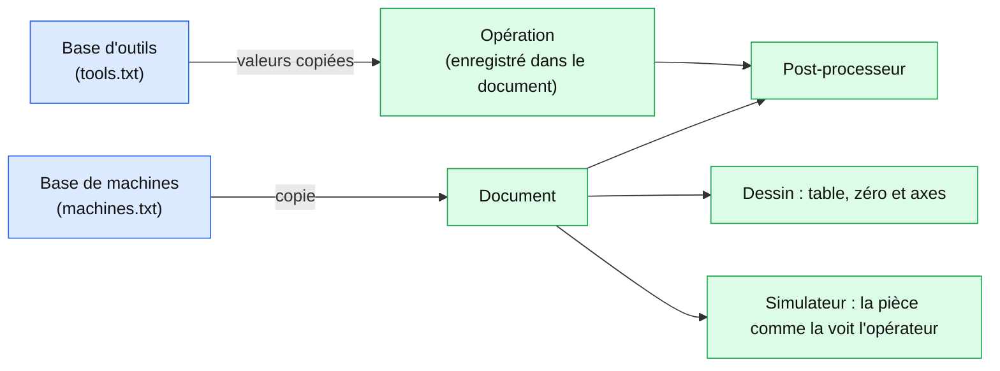

# Outils, torches et machines

*English version: [TOOLS-MACHINES.en.md](TOOLS-MACHINES.en.md).*

Cette page décrit comment sont définis un **outil** et une **machine**, et ce qu'ils changent dans les opérations, le post-processeur et le simulateur. Les scripts CAO sont dans [CAD-SCRIPTS.fr.md](CAD-SCRIPTS.fr.md), les post-processeurs dans [POSTPROCESSOR.fr.md](POSTPROCESSOR.fr.md), le simulateur dans [SIMULATOR.fr.md](SIMULATOR.fr.md).

## 1. La base d'outils

**Usinage > Outils...** ouvre la fenêtre des outils : la liste à gauche (`T1  Fraise 6 mm`), les champs de l'outil sélectionné à droite, et les boutons **Nouveau** et **Supprimer** (après une suppression, l'outil suivant est sélectionné, ou le précédent si c'était le dernier). Chaque modification est enregistrée aussitôt dans `tools.txt`, dans le dossier de données de l'application (`~/.openpostpro`, ou le dossier donné par la variable d'environnement `OPP_PROFILE`).

| Champ | Sens |
|---|---|
| Numéro | le numéro `Tn` du programme ; unique. Un numéro déjà pris est refusé (un nouvel outil prend le premier numéro libre) |
| Nom | texte libre, affiché dans les listes |
| Type | *Fraise*, *Torche plasma*, *Jet d'eau*, *Électro-érosion* |
| Diamètre | le diamètre de la fraise, ou la **largeur de coupe** d'une torche |
| Avance | l'avance de coupe, en mm/min |
| Descente, Hauteur de passe, Rotation, Sens horaire, Refroidissement | pour une fraise seulement |
| Nombre de dents | voir la section 5 |

>>>

## 2. L'outil d'une opération

Dans les propriétés d'une opération, le champ **Outil** fonctionne comme une liste éditable :

- Quand le numéro est celui d'un outil de la base, le champ affiche son **nom** (`T2  Fraise 6 mm`) ; le texte complet est dans l'infobulle. Sinon il affiche le numéro.
- Un clic sur le champ permet de saisir un numéro (Entrée valide, Échap annule). La flèche à droite ouvre la liste des outils.
- Choisir un outil **copie ses valeurs dans l'opération** : rayon (diamètre / 2), avance, avance de finition, descente, hauteur de passe, vitesse et sens de la broche, refroidissement, et son type. Elles restent modifiables dans l'opération. Modifier ensuite l'outil dans la base ne change pas les opérations qui l'ont déjà utilisé : l'opération est autonome, et un document ouvert sur un autre ordinateur garde ses valeurs.

L'opération enregistre ces nouvelles valeurs dans le document (type d'outil, hauteur de passe, vitesse et sens de la broche, refroidissement, descente oblique). Un document enregistré avant l'ajout de ces champs est lu avec les valeurs par défaut.

## 3. Les torches

Un outil dont le type n'est pas *Fraise* est une **torche**. Une opération qui l'utilise :

- cache ce qu'une torche n'a pas : vitesse et sens de broche, refroidissement, descente, hauteur de passe, descente oblique ;
- est écrite dans le programme en **une seule passe** à la profondeur de l'opération (la hauteur de coupe), sans paliers ;
- désactive les boutons **Poche** et **Perçage** de la barre d'outils du dessin tant qu'il est l'opération courante.

Dans le simulateur, quand la première opération du document utilise une torche, l'outil est une torche plasma : elle coupe le bloc **de part en part** le long de ses déplacements d'usinage (G1, G2, G3), quelle que soit sa hauteur (une torche reste au-dessus de la tôle, à 0,5 mm par exemple). Quand le programme allume la torche (M3 ou la commande torche), elle ne coupe que pendant qu'elle est allumée ; si le programme ne l'allume jamais, tous les déplacements d'usinage coupent.

## 4. Descente oblique

Au début d'un parcours avec une **entrée** (une ligne ou un arc, réglage *Départ* de l'opération), l'outil peut descendre le long de l'entrée au lieu de plonger à la verticale. La case **Descente oblique** s'affiche dans l'opération quand le départ n'est pas *Normal* (et pour une fraise seulement).

- L'outil va à la hauteur de la surface au-dessus du début de l'entrée (rapide), puis fait l'entrée en descendant, à l'avance de descente, et arrive à la profondeur de la passe à la fin de l'entrée. Un arc donne une hélice.
- La première passe part de l'origine (la surface) ; les suivantes, de la profondeur de la passe précédente.
- Sans entrée (départ *Normal*), ou quand l'outil est déjà à la profondeur, la descente reste verticale.

## 5. L'abaque de coupe

Dans la fenêtre des outils, pour une fraise, les champs **Nombre de dents**, **Matériau usiné** et **Vitesse de broche maximale**, et le bouton **Calculer depuis l'abaque** (en haut à droite) remplissent la vitesse de broche, l'avance, la descente, la hauteur de passe et le refroidissement de l'outil.

- Vitesse de broche : `n = Vc × 1000 / (π × D)`, limitée au maximum de la machine (un message l'indique ; l'avance suit la vitesse réduite).
- Avance : `F = n × dents × fz`, où `fz` (avance par dent) est interpolée entre les colonnes 3, 6, 12 et 20 mm du matériau.
- Descente : une part de l'avance (30 à 50 %). Hauteur de passe : une part du diamètre (0,2 × D pour l'inox, jusqu'à 1 × D pour le bois). Refroidissement : brouillard pour l'aluminium, arrosage pour les aciers.

Matériaux : aluminium, laiton et cuivre, acier doux, inox, bois dur, bois tendre, MDF et contreplaqué, plastique.

Ce sont des valeurs indicatives pour des fraises carbure (rainurage, ébauche), en millimètres. Elles dépendent de la machine, de sa rigidité et de l'outil : ajustez-les dans la base et vérifiez le catalogue du fabricant de vos outils. La table est dans `src/cam/feeds.cpp`.

## 6. Les machines

**Usinage > Machines...** ouvre la base des machines (`machines.txt`, même dossier que les outils). Une machine a :

| Champ | Sens |
|---|---|
| Nom | unique |
| Course X, Y, Z | la zone utile de la table (X par Y) et la hauteur |
| Origine | le zéro de la machine sur la table : bas gauche, bas droite, haut gauche, haut droite, centre. **L'origine du dessin est le zéro de la machine** : la zone est autour |
| X, Y, Z inversé | l'axe compte dans l'autre sens que l'opérateur le voit (X qui croît de droite à gauche, par exemple) |

Les boutons **Appliquer** et **Aucune machine** règlent la machine du document. Le document garde une copie de la machine, pour rester complet sur un autre ordinateur.

Dans le dessin, la zone de la table est dessinée sous les formes, avec le zéro de la machine et deux flèches X et Y qui montrent le sens dans lequel la machine compte (un axe inversé pointe de l'autre côté). Quand une forme d'un calque visible sort de la zone, le contour de la table devient rouge avec un message. **Cadrer le dessin** (le bouton en haut au centre du dessin, ou la touche Début) montre la table quand le dessin est vide.

Dans le post-processeur, un axe inversé change le signe des valeurs du programme (le dessin a les valeurs que voit l'opérateur) :

- X, Y, Z des déplacements et des cycles de perçage, et la hauteur de dégagement ;
- le centre d'un arc (I, J, relatif ou absolu) ;
- le sens d'un arc : si un seul des axes X et Y est inversé, les arcs tournent dans l'autre sens (G2 devient G3) ; si les deux le sont, le sens est conservé ;
- la hauteur de sécurité, y compris celle du début du programme.

Un parcours hors de la zone est écrit quand même, avec un commentaire `WARNING` dans le programme et une ligne dans le journal. Les profils ne changent pas.

Dans le simulateur, le programme du document est relu à travers la machine : la pièce apparaît comme dans le dessin, comme la voit l'opérateur. Les cartes de position affichent ces valeurs. Le bloc de matière est au moins la table de la machine.
